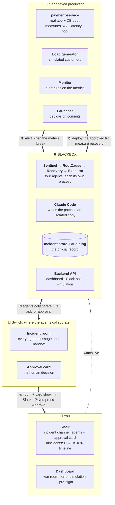
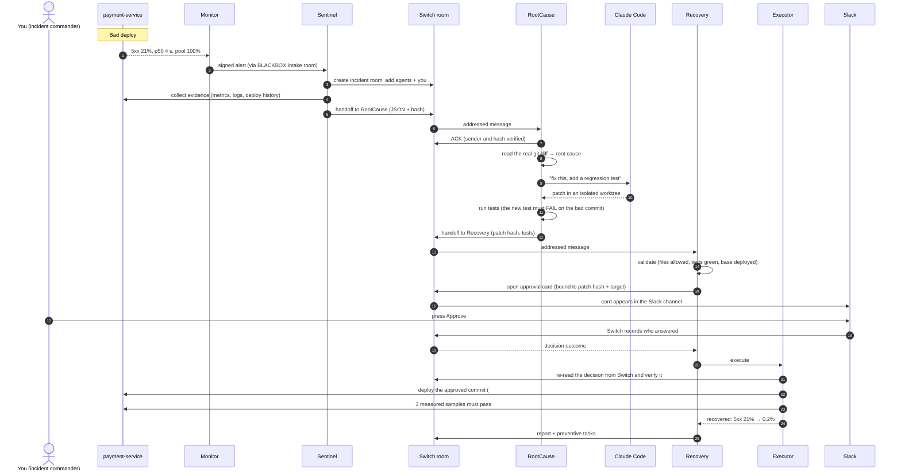
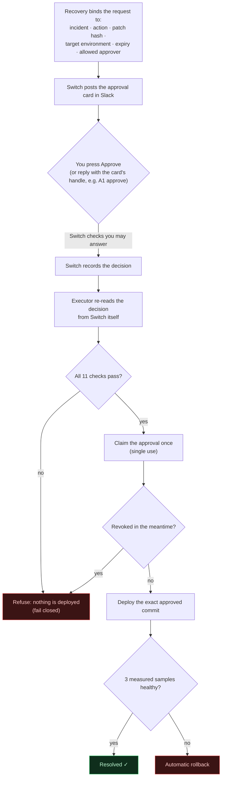
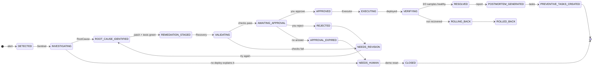
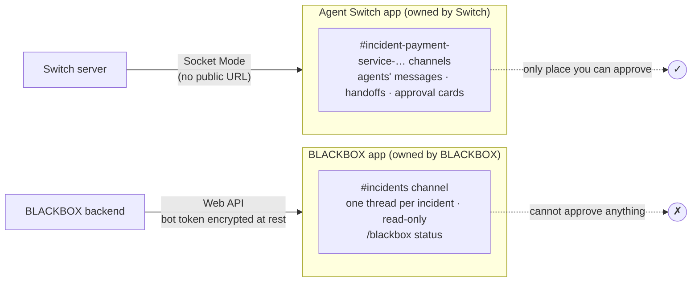

# BLACKBOX

An autonomous incident commander for the **Flip the Switch** hackathon (WeMakeDevs × Switch). Specialized AI agents collaborate in Switch rooms to investigate, patch and recover from production incidents, and a human approves every consequential action through a genuine Switch decision.

> **Status:** working end to end on Switch and Slack.
> - A faulty deploy is detected, diagnosed and fixed by Claude Code, approved by a human on a Switch card in Slack, deployed and verified. Run INC-1043 took 2 min 9 s.
> - The dashboard has a live **war room** for each incident, an **Error simulation** page with four real fault scenarios, and a **demo pre-flight** checklist.
> - The design docs are in [`docs/`](docs/).

## For judges: run it locally

A full run takes about **20 minutes the first time** (most of it is starting Switch) and about **3 minutes per incident** after that. If you only want to see it work, the demo video shows one complete live run.

### What you need

| Tool | Why |
|---|---|
| [uv](https://docs.astral.sh/uv/) 0.13+ | Backend, agents and simulator (it installs Python 3.12 itself) |
| Node.js 22+ and npm 10+ | Dashboard |
| Docker with Compose v2 | The Switch stack |
| GNU make | Every command below |
| [Claude Code](https://docs.claude.com/en/docs/claude-code) (`claude` on `PATH`, logged in) | RootCause uses it to write the fix. Without it, a clearly labelled fallback patch is used. |
| A Slack workspace (optional) | Without Slack, incident rooms and approval cards use the Mattermost bundled with Switch |

Ports used on `127.0.0.1`: **5180** dashboard, **8010** BLACKBOX API, **8090** payment-service, **8100** Switch, **3000** Switch Gateway, **8065** Mattermost.

### Step 1: install BLACKBOX

```bash
git clone https://github.com/suryafk/FlipTheSwitch.git && cd FlipTheSwitch
```

```bash
make setup
```

This creates `.env` from `.env.example` and installs the backend and frontend dependencies.

### Step 2: start Switch

Run the official self-hosted Switch stack (see [docs.switchagents.ai](https://docs.switchagents.ai/switch-rooms/getting-started)) with these settings, which BLACKBOX was built and tested against:

- version `SWITCH_VERSION=0.31.0`
- Compose profiles `collab` and `gateway` (switch-core, Postgres, Mattermost, Gateway)
- `API_HOST_PORT=8100`
- Compose project name `blackbox-switch`, so the container is `blackbox-switch-switch-1` (`make demo-reset` restarts it; export `SWITCH_CONTAINER` if yours is named differently)

Check it is up:

```bash
curl http://127.0.0.1:8100/health
```

Then sign in to the Gateway at http://localhost:3000 with the admin account the Switch setup created.

### Step 3: fill in `.env`

Only these values are required. Everything else has a working default, and every variable is explained in [`.env.example`](.env.example).

| Variable | Value |
|---|---|
| `SWITCH_API_URL` | `http://127.0.0.1:8100` (the default) |
| `SWITCH_GATEWAY_ADMIN_EMAIL`, `SWITCH_GATEWAY_ADMIN_PASSWORD` | Your Gateway admin login. Used once, to mint a registration key so the agents belong to you. Alternatively set `SWITCH_REGISTRATION_KEY` to a key minted in the Gateway. |
| `SWITCH_IC_CHAT_USERNAME` | Your username in the chat app where you will approve (Mattermost default: `user`) |
| `SIM_LAUNCHER_TOKEN` | Any random string, e.g. `openssl rand -hex 32` |
| `BLACKBOX_WEBHOOK_SECRET` | Another random string |

### Step 4: register the agents (one time)

```bash
make agents-bootstrap
```

This registers Sentinel, RootCause, Recovery and Executor in Switch, pins their identities and creates the intake room. If it prints a check message, post it in the new intake channel.

**Optional, to run on Slack:** in the Gateway, open **Apps → Register messaging app** and connect Slack. Run `make switch-bridges`, put the Slack connection's id in `SWITCH_INCIDENT_BRIDGE_ID`, set `SWITCH_IC_CHAT_USERNAME` to your Slack identity, and run `make agents-bootstrap` again. The separate read-only `#incidents` timeline bot is optional; see [`docs/11-SLACK-INTEGRATION.md`](docs/11-SLACK-INTEGRATION.md).

### Step 5: reset and start the demo

```bash
make demo-reset
```

In about 30 seconds this closes anything left open, resets the sandbox to the healthy release (#841), restarts Switch for a fresh chat session, starts the stack (launcher, payment-service, load generator, monitor, API and agents) and waits until the pre-flight checklist is green. It ends with `READY FOR THE DEMO`.

Start the dashboard in a second terminal:

```bash
make dev-frontend
```

### Step 6: break production and watch it heal

1. Open http://localhost:5180 and go to **Error simulation**.
2. On **Database pool exhaustion**, press **Trigger**, then **Break it**. This deploys a real bad config change that cuts the DB pool from 50 to 10.
3. Open the incident's **war room** from the link that appears. Within about a minute the agents have detected it, collected evidence, read the git diff, had Claude Code write a fix plus a regression test, and validated it.
4. In the incident's chat channel (Mattermost or Slack), find the **approval card**. Try typing "approve" first: nothing happens, because only the card counts. Then press **Approve**.
5. The Executor re-checks your decision with Switch, deploys the fix and confirms recovery over three measured samples. The war room turns green (typically 5xx ~25% → ~0.2%).

Run another incident with `make demo-reset` first; only one incident can be open at a time. The other scenarios are on the same page (a pool sized against the wrong limit, a card-processor timeout regression, and a traffic surge with no bad deploy, where the agents correctly escalate to a human instead of patching).

From the terminal instead of the dashboard:

```bash
make sim-trigger SCENARIO=pool-exhaustion
```

Stop everything:

```bash
make stack-down
```

### No Switch? Check the code and tests

The API and dashboard run on their own, and the test suites need no external services:

```bash
make test
```

```bash
make lint
```

### If something goes wrong

| Symptom | Fix |
|---|---|
| `make preflight` shows a FAIL line | Each line prints its own fix; most are solved by `make demo-reset` |
| Pressing Approve does nothing | Switch's Slack session went stale: `docker restart blackbox-switch-switch-1` (`make demo-reset` does this). BLACKBOX fails closed, so nothing is deployed meanwhile. |
| Mattermost hangs (seen on arm64) | `docker restart blackbox-switch-mattermost-1`, wait about 20 s |
| RootCause uses a "fallback patch" | `claude` is not on `PATH` or not logged in; set `BLACKBOX_CLAUDE_BIN` if it lives elsewhere |
| "The service is not on the healthy baseline" on the simulation page | The last fix is still deployed: `make demo-reset` |

## Architecture

BLACKBOX is a team of AI agents that responds to a production incident the way a good on-call team would. It notices the problem, finds the cause, writes and tests a fix, **asks a human for permission**, deploys the fix and proves the service recovered. The agents work together through **Switch**. Humans watch and decide in **Slack**, and the **BLACKBOX dashboard** shows everything live.

### 1. The big picture

Four layers, and the six steps that connect them. Section 2 shows each step in detail.



**In plain words:**

- **The sandbox** is a small but real payment service. Simulated customers send it traffic, and it measures its own error rate, latency and database-pool use. Releases are real git commits that a launcher deploys.
- **The monitor** watches those measurements. When a rule trips, it sends a signed alert to BLACKBOX.
- **The agents** are separate processes. They never call each other directly; they talk only through **Switch rooms**, so every step is visible and recorded.
- **Switch** hosts the incident room and the **approval card**. Its Slack connection puts both into a Slack channel.
- **The BLACKBOX backend** keeps the official record (the incident store and an append-only audit log) and serves the dashboard.
- **You** watch in Slack and the dashboard, and make the one decision that matters: approve or reject the fix.

### 2. One incident, start to finish

A real run (INC-1043) took **38 s from alert to approval request** and **2 min 9 s to resolution**.



### 3. Who does what

| Agent | Job | Allowed to | Never does |
|---|---|---|---|
| **Sentinel** | Turn an alert into an incident | Read metrics, logs and deploy history; create the room; hand off | Change code or deploy |
| **RootCause** | Find the cause and fix it | Read the repo and diff; run Claude Code in an isolated copy; run tests | Deploy, or skip the tests |
| **Claude Code** | Write the patch | Read, edit and search files in its worktree (no shell, no network tools) | Commit, run commands, leave its folder |
| **Recovery** | Check the fix, get a human decision | Validate; open the Switch approval card; write the report | Deploy anything itself |
| **Executor** | Ship the approved fix and prove it worked | Deploy **only** a commit whose approval it has re-verified with Switch | Act on chat messages or on Recovery's word alone |

### 4. Why an approval can be trusted

The approval is the safety gate, so nothing takes anyone's word for it. **Typing "approve" in chat does nothing.** Only the Switch card counts, and the executor checks it again itself.



The 11 checks:
- the request id matches the binding, and the stored card is unchanged
- the patch hash was shown on the card
- the decision was read from Switch
- state is answered, and the answer is approve
- the approver is allowed
- it was answered before expiry, and hasn't expired now
- this is its first use
- it hasn't been revoked

Changing a card's content after it's opened is refused by Switch itself (HTTP 409).

### 5. Incident lifecycle

Every state change is checked against a transition table (only the named agent may make each move) and written to the audit log.



### 6. Where things live, and the two Slack apps



| Data | Where | Notes |
|---|---|---|
| Incidents, handoffs, patches, approvals, executions | `backend/data/blackbox.db` (SQLite) | The official record |
| Audit log | `audit_events` table | Append-only: database triggers block edits and deletes |
| Switch events each agent processed | `switch_events` table | Event id, sequence and timestamp; prevents double processing |
| Agent identities | `backend/data/switch/agents/*.json` | API keys, file mode 600, git-ignored |
| Sandbox releases and deploy history | `simulator/runtime/` | Git-ignored; rebuilt by `make demo-reset` |

### 7. Error simulation

The **Error simulation** page in the dashboard sidebar injects one real fault at a time:

| Scenario | How it breaks (real) | Expected agent response |
|---|---|---|
| Database pool exhaustion | Deploy cuts `pool_size` 50 → 10 | Diagnose, patch, you approve, recover |
| Pool matched to the wrong limit | Deploy sets `pool_size` 12, timeout 1 s | Same diagnosis, different numbers |
| Card processor timeout regression | **Code** deploy adds a 40 ms timeout (about 25% 502s) | Root cause from the code diff; Claude Code fixes the code |
| Traffic surge | Load ×5, **no deploy** | Investigate, find nothing to patch, **escalate to you** |

### 8. What's real and what's simulated

| Real | Simulated |
|---|---|
| The payment service, its database pool, its measurements and logs | The customers (load generator) |
| The git history, the deploys and the rollback | The card processor's behaviour |
| Claude Code writing the patch; the test runs | The "production" environment is a local sandbox |
| Switch rooms, handoffs, approval cards and decisions | |
| Slack channels, cards and notifications | |
| The before and after numbers | |

### 9. Running a demo

```bash
make demo-reset
```

This takes about 30 s. It closes leftovers, resets the sandbox, restarts Switch for a fresh Slack session, starts everything, and waits until the pre-flight checklist is green. The checklist is also on the dashboard.

Then open the dashboard (http://localhost:5180), go to **Error simulation**, and trigger a scenario. Watch the war room and the Slack incident channel, and press **Approve** on the card.

```bash
make preflight
```

This prints the same checklist in the terminal.

## Repository layout

```
backend/     Python 3.12+ · FastAPI · SQLAlchemy · Alembic · SQLite   (the control-plane API)
frontend/    React 19 · TypeScript · Vite · Tailwind CSS 4            (the operator UI)
simulator/   payment-service simulation: demo app + git history, launcher, load, monitor
scripts/     stack.sh: start/stop the local demo stack
infra/       Docker Compose for the local stack
docs/        architecture, security, simulation, UX, feasibility and review documents
Blackbox.md  original product brief
Makefile     every developer command (run `make help`)
```

## Prerequisites

| Tool | Version used | Needed for |
|---|---|---|
| [uv](https://docs.astral.sh/uv/) | 0.13+ | Backend dependencies and Python (it can download Python 3.12+ itself) |
| Node.js and npm | Node 22+ (tested on 26.5), npm 10+ | Frontend |
| Docker with Compose v2 | Docker 29, Compose 5 | The Docker stack (optional for local development) |
| GNU make | 3.81+ | Convenience commands |

## Quick start (local development)

```bash
make setup
```

This creates `.env` from `.env.example` (if it is missing), runs `uv sync` in `backend/` and `npm ci` in `frontend/`.

Start the API in one terminal. It serves http://localhost:8010 and runs database migrations automatically at startup:

```bash
make dev-backend
```

Start the UI in a second terminal. It serves http://localhost:5180 and proxies `/api` to the backend:

```bash
make dev-frontend
```

Open http://localhost:5180. The dashboard shows the live result of `GET /api/health`.

Call the health endpoint directly:

```bash
curl http://localhost:8010/api/health
```

Expected response:

```json
{"status":"ok","service":"blackbox-backend","version":"0.1.0","environment":"development",
 "checks":{"database":{"status":"ok","detail":null},"migrations":{"status":"ok","detail":"at 0004_switch_events"}}}
```

`GET /api/health/live` is a dependency-free liveness probe. `GET /api/health` returns **503** with `"status":"degraded"` when the database or migrations are not OK.

The backend and frontend run independently. The frontend shows "API unreachable" when the backend is down, and the backend needs nothing from the frontend.

## Docker

Build and start the backend and frontend containers:

```bash
make up
```

| Service | URL | Notes |
|---|---|---|
| Web UI (nginx) | http://localhost:8088 | nginx proxies `/api` to the backend container |
| API | http://localhost:8010/api/health | Data in the `blackbox_backend-data` volume |

Other commands:

```bash
make ps
```

```bash
make logs
```

```bash
make down
```

`make down` stops the containers and keeps the data volume. `make clean` also deletes the data volume and local build outputs.

Ports bind to `127.0.0.1` only. Change them in `.env` (`BLACKBOX_BACKEND_PORT`, `BLACKBOX_FRONTEND_PORT`, `BLACKBOX_WEB_PORT`).

## Tests, lint and format

Run all tests (backend pytest and frontend vitest):

```bash
make test
```

Run the checks: ruff and format check for the backend; ESLint, Prettier check and `tsc` for the frontend.

```bash
make lint
```

Auto-format both projects:

```bash
make format
```

Individual suites: `make test-backend`, `make test-frontend`.

## Configuration

All configuration is through environment variables. They are read from the repository-root `.env`, which the backend, the Vite dev server and Docker Compose all use. Every variable is documented in [`.env.example`](.env.example).

- **Secrets** live only in `.env`, which is git-ignored, and are never committed:
  - Switch admin and agent keys
  - the simulator launcher token and webhook secret
  - Slack app credentials
  - `BLACKBOX_SECRET_KEY`, which encrypts the Slack bot token at rest

  `.env.example` documents every variable with empty values. Agent API keys are stored in `backend/data/switch/agents/` with file mode 600.
- **Database:** SQLite at `backend/data/blackbox.db` locally, and `/data/blackbox.db` in Docker. Run migrations with `make migrate`; they also run at startup when `BLACKBOX_AUTO_MIGRATE=true`.
- **Logging:** `BLACKBOX_LOG_FORMAT=json` gives one JSON object per line. `console` is human-readable. Every request is logged once, with its `X-Request-ID`.

## Switch integration proof (Task 10)

These commands demonstrate a real integration with a running Switch server: agent registration, room creation, an agent message, a received event, a Switch approval card, and **independent verification** of the human's decision. Results and limitations are in [`docs/10-SWITCH-INTEGRATION-PROOF.md`](docs/10-SWITCH-INTEGRATION-PROOF.md).

The Switch stack must be running, and the `SWITCH_*` settings must be set in `.env` (see `.env.example`).

Run the proof with a person acting in Mattermost when prompted:

```bash
make switch-proof
```

Run it unattended; the TEST HARNESS acts as the IC through Mattermost's API:

```bash
make switch-proof-auto
```

Re-verify the latest stored approval in a fresh process:

```bash
make switch-verify
```

Approving in this phase executes nothing.

## Run the incident demo

Full details are in [`docs/11-AGENTS-AND-SIMULATION.md`](docs/11-AGENTS-AND-SIMULATION.md) and [`docs/12-SWITCH-INTEGRATION-IMPLEMENTATION.md`](docs/12-SWITCH-INTEGRATION-IMPLEMENTATION.md).

**Prerequisites:**
- a running Switch stack
- the Switch, simulator and Slack settings in `.env`
- the `claude` CLI logged in

Register the agents (one time; with Slack, post the printed check message in the new Slack intake channel):

```bash
make agents-bootstrap
```

Before each demo, reset everything to a known-good state. This takes about 30 s and ends with the pre-flight checklist:

```bash
make demo-reset
```

Then open http://localhost:5180 and go to **Error simulation** to trigger a scenario. Or use the command line:

```bash
make sim-trigger SCENARIO=pool-exhaustion
```

Watch the incident's war room and its Slack channel, then press **Approve** on the card. Check readiness at any time:

```bash
make preflight
```

Stop everything with:

```bash
make stack-down
```

## API conventions (Phase 1)

- Errors always use the shape `{"error": {"code", "message", "request_id", "details?"}}`.
- Unexpected errors return a generic 500 and are logged with a traceback. Internal details are never returned.
- `X-Request-ID` is accepted (if it contains only safe characters, ≤ 64 of them) or generated, then echoed back and included in logs.
