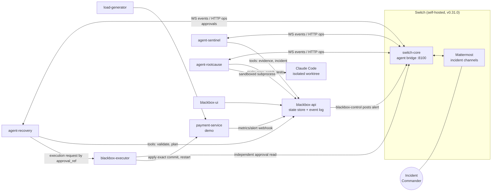
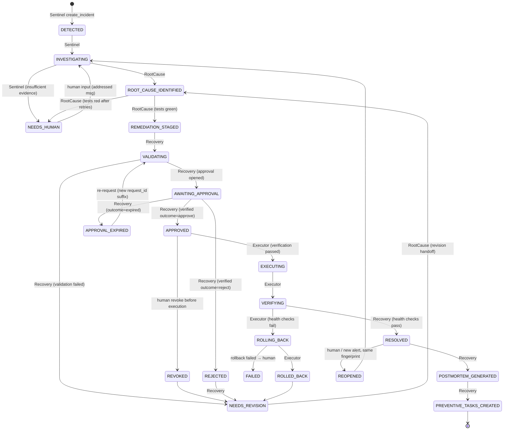
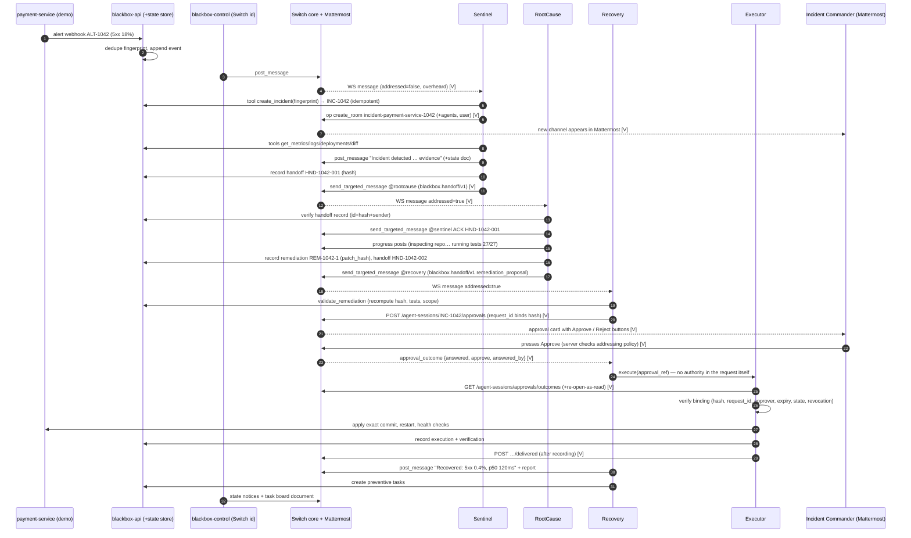

# 03 — BLACKBOX Multi-Agent Architecture

| | |
|---|---|
| **Status** | Design. No application code. |
| **Builds on** | [`00-PROJECT-UNDERSTANDING.md`](00-PROJECT-UNDERSTANDING.md), [`01-SWITCH-RECONNAISSANCE.md`](01-SWITCH-RECONNAISSANCE.md) (§19 = runtime-verified Switch behavior), [`01-SWITCH-CAPABILITY-MATRIX.md`](01-SWITCH-CAPABILITY-MATRIX.md) |
| **Companions** | [`03-AGENT-CONTRACTS.md`](03-AGENT-CONTRACTS.md) (per-agent contracts), [`03-HANDOFF-SCHEMAS.md`](03-HANDOFF-SCHEMAS.md) (wire formats, context contract, idempotency), [`03-AGENT-PROMPT-DESIGNS.md`](03-AGENT-PROMPT-DESIGNS.md) (system prompts) |

Every Switch behavior this design relies on is tagged:

| Tag | Meaning |
|---|---|
| **[V]** | Verified live in S1–S5 (2026-11-07) |
| **[S]** | Read from Switch source or docs, but not yet run |
| **[C]** | Custom BLACKBOX behavior |

---

## 1. Design principles

1. **Switch is the only channel between agents.** No agent calls another agent's code, queue or function. Every handoff, acknowledgement, progress report and escalation is a Switch room message. Approvals are Switch approval requests **[V]**. An agent can only learn about work through its Switch event stream **[V]**.
2. **BLACKBOX state is the source of truth; Switch is the shared, visible medium.**
   - Agents read and write the shared incident record through BLACKBOX tool APIs, which are typed, validated and append-only.
   - Agents never *trigger* each other through those APIs.
   - Each handoff is recorded in the state store first and then posted to Switch. The receiver acts only on the Switch event, and cross-checks it against the store (§7).
3. **The LLM proposes; deterministic code disposes.** LLMs write hypotheses, analyses, patches and narratives. The following are deterministic code paths that an LLM cannot override:
   - state transitions
   - hash computation
   - approval binding and verification
   - execution
   - idempotency
4. **Fail closed.** If authorization, identity or artifact integrity cannot be proven, nothing executes. Chat can **stop** work (revoke, halt). Only a verified Switch approval can **start** consequential work.
5. **Separation is enforced by BLACKBOX, not Switch.** Switch gives same-owner agents identical authority **[S]**. Each agent is therefore:
   - a separate process,
   - with its own Switch API key,
   - its own tool allowlist,
   - and its own filesystem scope.
6. **Disclose simulation.** The mock monitoring data, the deployment metadata and any deterministic coding fallback are labelled `SIMULATED` in the room, the UI and the report.

---

## 2. Participants

### 2.1 Switch identities

There are four agent identities and one human, all in Switch.

| Identity (Switch name) | Kind | LLM? | Purpose |
|---|---|---|---|
| `blackbox-control` | Agent (`always_on`) | **No** | Deterministic system voice. It posts injected alerts into the intake room, posts state-transition notices, owns the incident-state room document, and posts watchdog nudges and escalations. It is the "ingestion service" with a Switch identity, so alerts reach Sentinel as genuine Switch events. |
| `blackbox-sentinel` | Agent (`always_on`) | Yes | Detection and investigation (§3 of the contracts) |
| `blackbox-rootcause` | Agent (`always_on`) | Yes, plus a coding agent | Diagnosis and remediation |
| `blackbox-recovery` | Agent (`always_on`) | Yes (narrative only) | Validation, approval request, controlled execution |
| `user` (incident commander) | Human (Mattermost, linked to the Gateway admin) | — | Approves or rejects in Switch **[V]** |

All four agents are registered with the incident commander's **personal registration key** **[V]**, so the commander owns them. That ownership is what lets the commander answer their approval cards **[V]**.

`blackbox-control` is a fourth identity beyond the three in `Blackbox.md`. It is needed because Switch delivers only messages *written by a participant* **[V]**: an alert must be posted by *someone* for Sentinel to overhear it. It contains no AI and is labelled as the system voice.

### 2.2 Rooms

| Room | Created by | Members | Purpose |
|---|---|---|---|
| `blackbox-intake` (standing) | Bootstrap script | `blackbox-control`, `blackbox-sentinel`, `user` | Alerts land here; humans can report incidents here; Sentinel overhears **[V]** |
| `incident-<service>-<n>` (one per incident) | Sentinel, via `create_room` **[V]** | All four agents and `user` | The war room: all collaboration, the approval card, the report |

### 2.3 BLACKBOX services

| Service | Process | Holds | Notes |
|---|---|---|---|
| `blackbox-api` (FastAPI) | 1 | SQLite state store and append-only event log; the `blackbox-control` Switch key | Webhook ingestion, incident state API (agent tools), state-machine validator, watchdog, UI API with an SSE feed to React |
| `agent-sentinel` | 1 | The Sentinel Switch key; read-only observability tools | WebSocket client **[V]** |
| `agent-rootcause` | 1 | The RootCause Switch key; read access to the demo repo; write access to an **isolated git worktree** | Invokes the coding agent (Claude Code headless) as a sandboxed subprocess |
| `agent-recovery` | 1 | The Recovery Switch key | Opens approvals **[V]**. Calls the executor. **Cannot execute.** |
| `blackbox-executor` | 1 | A read-only use of the Recovery Switch key (to read approval outcomes); the sandbox deploy credential | The **only** component that can change the demo service. It verifies independently before acting (§6). |
| `payment-service` (demo) | 1 | — | Simulated service with `/health` and `/metrics`, real config in the demo repo |
| `load-generator` | 1 | — | Produces the real 5xx and latency signal |
| `blackbox-ui` (React) | 1 | — | Dashboard, war room and report |
| Switch stack | 5–6 containers | — | postgres, switch-core, mattermost, setup, gateway **[V]** |

All arrows between agents pass through `switch-core`. The state store is shared memory, not a messaging path.

---

## 3. Incident lifecycle (corrected state machine)

This corrects the defects listed in `00-PROJECT-UNDERSTANDING.md` §9.1. `blackbox-api` validates every transition against a table of `(from, to, allowed_actor)` entries and appends it to the event log. Each consequential transition is also announced in the room by `blackbox-control`.

**Invariants** (enforced in code):

- There is no path from `REJECTED`, `REVOKED`, `APPROVAL_EXPIRED` or `NEEDS_REVISION` to `EXECUTING`.
- `RESOLVED` requires a `VERIFYING` record with all health checks passing.
- A remediation that is revised gets a **new** `remediation_id` and hash. The old approval cannot match it, by construction **[V]** (`REQUEST_CONFLICT`).
- Reopening appends to the log. History is never rewritten.
- `MAX_REVISION_CYCLES = 3` per incident. Hitting it moves the incident to `NEEDS_HUMAN`.

---

## 4. Choreography

### 4.1 What triggers Sentinel

Sentinel's WebSocket connection uses `scope=all`, `filter=all` **[V]**. It covers `blackbox-intake` and every incident room it belongs to.

| Trigger | Switch event | Detection rule (deterministic first, then LLM) |
|---|---|---|
| Injected or monitoring alert | `message` in `blackbox-intake` from `blackbox-control`, whose body contains a fenced `blackbox.alert/v1` JSON block | Sender id equals the known control id, **and** the schema is valid → triage |
| Explicit human incident report | `message` in `blackbox-intake` from a human, **either** `addressed=true` **or** overheard and the LLM classifier says "incident report" (confidence ≥ 0.7) | Overheard reports get a confirmation question first ("@user is this an incident? reply yes") before an incident is created |
| A human adds context to an open incident | `message` in an incident room, from a human, overheard | Appended to the evidence; no new incident |
| Direct request | `message` with `addressed=true` in any room | Handled as a command or question |

Sentinel ignores:

- its own messages;
- other agents' messages that are not addressed to it;
- `room_join` events;
- `command` events.

### 4.2 Sequence diagram: Switch-mediated communication

### 4.3 Step-by-step rules

**When Sentinel hands off to RootCause.** All of the following must hold:

1. The incident exists, and its room exists and is joined.
2. The evidence package contains at least one *anomaly* evidence item (a metric beyond its threshold) **and** at least one *candidate cause* item (a deployment or config change within 30 min before onset, or a log signature).
3. At least one hypothesis exists with confidence ≥ 0.4.
4. Severity has been assigned.

If any of these fails after the investigation budget is spent, Sentinel follows Failure A (§8).

**How RootCause receives evidence.** RootCause receives the addressed Switch message carrying `blackbox.handoff/v1` (`type=investigation`). It then:

1. Checks that the sender's participant id equals Sentinel's known id.
2. Fetches the handoff record from the state store by `handoff_id`, and checks that `payload_sha256` matches the JSON in the message.
3. Loads the full evidence by `evidence_ref` from the store. Large logs never travel in chat.
4. Calls `read_context` **[V]** to pick up any human comments in the room.

**How RootCause reports progress.** It uses `post_message` in the incident room at each milestone:

- `ACK`
- `REPO_INSPECTED`
- `ROOT_CAUSE_FOUND`
- `PATCH_GENERATED`
- `TESTS_RUNNING`
- `TESTS_RESULT`
- `PROPOSAL_READY`

Each post is a short human line plus a fenced `blackbox.progress/v1` block. There is at most one post per milestone (idempotent by `progress_id`). Long output (the diff, test logs) is referenced, never pasted beyond 40 lines.

**When Recovery is activated.** Recovery acts only on an addressed `blackbox.handoff/v1` with `type=remediation_proposal`, from RootCause's participant id, whose state-store record is in `REMEDIATION_STAGED`. It does not act on room chatter.

**How Recovery validates a proposed patch.** This is deterministic (contracts §C.3):

1. Recompute `patch_hash` from the remediation commit in the isolated worktree. It must equal both the handoff and the store.
2. Check that the changed files lie inside the allowlisted paths (`config/**`, `src/**`, `tests/**`), with no CI, credential or infra files.
3. Check that the test results record exists, was produced by the BLACKBOX test runner (not by LLM text), has `failed=0`, and shows a count at least as large as the baseline.
4. Check that the target environment is `staging-sandbox` and is in the allowlist.
5. Check that the rollback plan exists and the rollback commit (the parent) resolves.
6. Compute a risk level from rules: config-only and small diff → low.

The LLM writes only the human summary.

**How the approval request is generated.** Recovery calls `POST /agent-sessions/{session_id}/approvals` **[V]** with:

| Field | Value |
|---|---|
| `session_id` | `INC-1042` |
| `turn_id` | `REM-1042-1` |
| `request_id` | `INC-1042:REM-1042-1:<patch_hash first 16 hex>:staging-sandbox[:r<k>]` (≤ 200 chars) |
| `title` | Action and target |
| `detail` | ≤ 4000 chars: the full patch hash, changed files, test count, risk, rollback, expiry |
| `options` | `approve` (`accept`) and `reject` (`decline`) |
| `room_id` | The incident room |
| `expires_at` | Now + 15 min (configurable, ≤ 24 h) |

Switch renders the card with buttons **[V]**. The server refuses any re-open of that `request_id` with different content **[V]**, so the card text cannot be swapped after it is opened.

**How the executor verifies the Switch decision.** See §6.

**Behavior after rejection.** See §8, Failure C.

**Resumption after an interruption.** See §5.

---

## 5. Interruption and resumption

| What fails | What happens |
|---|---|
| Agent process crash or restart | On start, each agent reads its `agent_runtime` row: `connection_id` and last position. It reopens the WebSocket with the **same** `connection_id` and a `start_at`/`start_from` position **[S]**. On a `gap` frame it calls `read_context` for each active incident room and reconciles. It then runs **resume scan**: it queries the state store for incidents whose current state is *owned by this agent* and that have no completion record, and re-enters the step handler. Handlers are idempotent (`03-HANDOFF-SCHEMAS.md` §6). |
| Recovery restarts while an approval is pending | On start it calls `GET /agent-sessions/approvals/outcomes` **[V]**. Outcomes stay owed until `/delivered`, so none are lost. It then processes them through the same idempotent handler. |
| Executor crash mid-execution | The `executions` row exists with `status=started`. On restart the executor never re-applies blindly. It inspects the sandbox: is the deployed commit equal to the approved hash? If it is, it continues to verification. If not, it marks the execution `aborted` and Recovery escalates. `/delivered` is sent only after the result is recorded, so the outcome can still be read back. |
| switch-core restart | Agents see the WebSocket drop and reconnect with backoff (250–750 ms for the first minute, then doubling up to 30 s, following `loadtest/agents.py`). Messages persist in Postgres **[S]**, and `read_context` recovers them. |
| Mattermost crash (seen in S3 on arm64) | Switch keeps working; the bridge reconnects **[V]** (after a restart). Agents keep posting. The approval card is (re)published on bridge resync **[S]**. The UI shows "chat bridge degraded". |
| An agent stalls (no ACK or progress within its SLA) | The `blackbox-api` watchdog makes `blackbox-control` post an addressed nudge in the room (`@blackbox-rootcause HND-1042-001 unacknowledged for 60 s`). After 2 nudges it escalates to the incident commander. All of this goes through Switch. |
| BLACKBOX API restart | SQLite (WAL) persists. Agents retry tool calls (§contracts retry policy). |

---

## 6. Executor verification (the governance core)

`blackbox-executor` is a separate process. Recovery can only *ask* it to act on an `approval_ref`, the BLACKBOX approval id. The request carries no authority, and the executor trusts nothing in it.

1. Load the approval record from the store: `incident_id`, `remediation_id`, `patch_hash`, `environment`, `session_id`, `request_id`, `room_id`, `approver_allowlist`.
2. Recompute `patch_hash` from the remediation commit in the worktree (§HANDOFF-SCHEMAS §5). Mismatch → **refuse**.
3. Recompute `request_id` from (incident, remediation, hash, environment, attempt). Mismatch → **refuse**.
4. **Read the decision from Switch.**
   - First, `GET /agent-sessions/approvals/outcomes`, looking for this `request_id` **[V]**.
   - If it is absent, re-POST the *identical* stored open body; the server returns the current row **[V]**. This works only before `expires_at`; afterwards it returns 422 **[V]**.
   - If neither returns a row → **refuse**.
5. Assert all of the following:
   - `state == "answered"`
   - `answer == "approve"`
   - `answered_by` is in `approver_allowlist` (the exact bridge-scoped id captured at bootstrap **[V]**)
   - `answered_at` is before `expires_at`
   - the current time is before `expires_at` (execution must start inside the approval window)
   - the room of the approval equals the incident room
6. Assert BLACKBOX state:
   - the incident is `APPROVED`;
   - there is no `revocations` row for this approval;
   - there is no `executions` row for this approval with status `started` or `succeeded` (a unique constraint).
7. Insert `executions(status=started)` inside the same transaction as the check (`BEGIN IMMEDIATE`).
8. Apply **exactly** the approved commit to the sandbox, restart, and run the health checks.
9. Record the result. Then `POST …/delivered` **[V]**.

Any exception in steps 1–7 → `execution_refused` event, a room post by Recovery, and no change.

The Recovery LLM never sees the Switch API key or the deploy credential. Those live only in process environment variables that tools use.

---

## 7. Why this is real Switch collaboration, not function calls

| Concern | How the design guarantees it |
|---|---|
| Agents must talk through Switch | The only inbound trigger an agent process has is its Switch WebSocket. The state-store APIs have **no** "notify agent" endpoint. |
| A human must see the conversation | Every handoff, ACK and progress milestone is a Mattermost-visible message **[V]** |
| Handoffs must be structured | A typed JSON block inside the message, validated against a schema. Not NL parsing. |
| Handoffs must not be forgeable from chat | The receiver checks (a) that the sender participant id is the expected agent, and (b) that the payload hash matches the sender's state-store record. A human pasting JSON into chat fails check (a). |
| The decision must be genuine | The approval card is answered through Switch's server-side authorization **[V]**. The executor reads it back from Switch **[V]**. |

---

## 8. Failure scenarios (summary; full behavior is in the contracts doc)

| Scenario | Expected behavior |
|---|---|
| **A. Sentinel gets an alert but finds no relevant evidence** | Sentinel still creates the incident and room (the alert is real). It posts "insufficient evidence". It runs one widened search: window ×2, all services, and log levels down to WARN. If that still finds nothing, it sets `NEEDS_HUMAN` and posts an addressed question to the incident commander listing what was checked and what is missing. **No handoff to RootCause.** A human reply (overheard or addressed) resumes `INVESTIGATING`. If the alert auto-clears (health OK for 5 min), Sentinel proposes closing it as a transient and needs a human "yes" to do so. |
| **B. RootCause's patch fails regression tests** | The patch stays in the worktree and is **never** handed to Recovery. RootCause posts the failing test names, then makes up to 2 more patch attempts, feeding the coding agent the failure output. If all attempts are red, it moves the incident to `NEEDS_HUMAN`, posts its diagnosis, the diff and the failures, and asks the commander to choose: a manual fix, rollback of deploy #842 as an alternative remediation (which goes through the same approval path), or more time. |
| **C. The approval is rejected or revoked** | **Rejected:** the outcome is verified, the state becomes `REJECTED` → `NEEDS_REVISION`, and the request is acknowledged as delivered. Recovery asks the commander in the card's thread for a reason, then sends a `revision_request` handoff to RootCause containing the reason. The next remediation has a new id and hash, so it gets a new card. **Revoked** (the commander posts `@blackbox-recovery revoke INC-1042`, or presses Revoke in the UI, before execution starts): a `revocations` row is written; if the request is still open, Recovery closes it **[V]**; the executor refuses; the state becomes `REVOKED` → `NEEDS_REVISION`. If execution has already started, revocation becomes an **abort-and-rollback** request, which runs the pre-approved rollback. **Expired:** the outcome is `expired` **[V]**. Recovery re-requests once with suffix `:r2`, then escalates. |

---

## 9. Mapping to `Blackbox.md` requirements

| Requirement | Where it is satisfied |
|---|---|
| Three distinct agents visible in the room | §2.1 (plus a disclosed system identity) **[V]** |
| At least two genuine handoffs | Sentinel→RootCause and RootCause→Recovery (plus Recovery→RootCause on revision) **[V]** |
| Shared memory | The state store and the context contract (`03-HANDOFF-SCHEMAS.md` §3), the room history **[V]**, and room documents **[V]** |
| Genuine Switch decision required | The approval request **[V]** |
| Independent verification | §6 **[V]** |
| Bound to incident, action, hash, environment, approver, status | The `request_id` construction, plus executor assertions |
| Rejected never executes; failed verification never resolves | §3 invariants |
| Auditable | The append-only event log storing Switch `event_id`s, `seq` numbers and approval rows |
| Tasks | **Custom** task records posted to the room and the task-board document (Switch tasks are not implemented **[V]**) |

## 10. Open items to verify before build

- ~~S6, S7~~: **verified** (recon §20). Consequences:
  - Re-run `connect_to_room` after any drop longer than 6 s.
  - Treat `taken_over` as terminal.
  - Room documents are single-writer, with the server enforcing 403 for other agents.
  - Human Mattermost input can be lost during a switch-core restart while the bridge reconnects. The approval read-back still fails closed.
- The maximum message length in Mattermost via Switch. We assume ≤ 16 000 chars, and design for ≤ 4 000.
- Whether `create_room` is idempotent on a duplicate name. It is unverified, so we guard with the state store.
- The coding-agent time budget (needed for the 35-second demo window).
