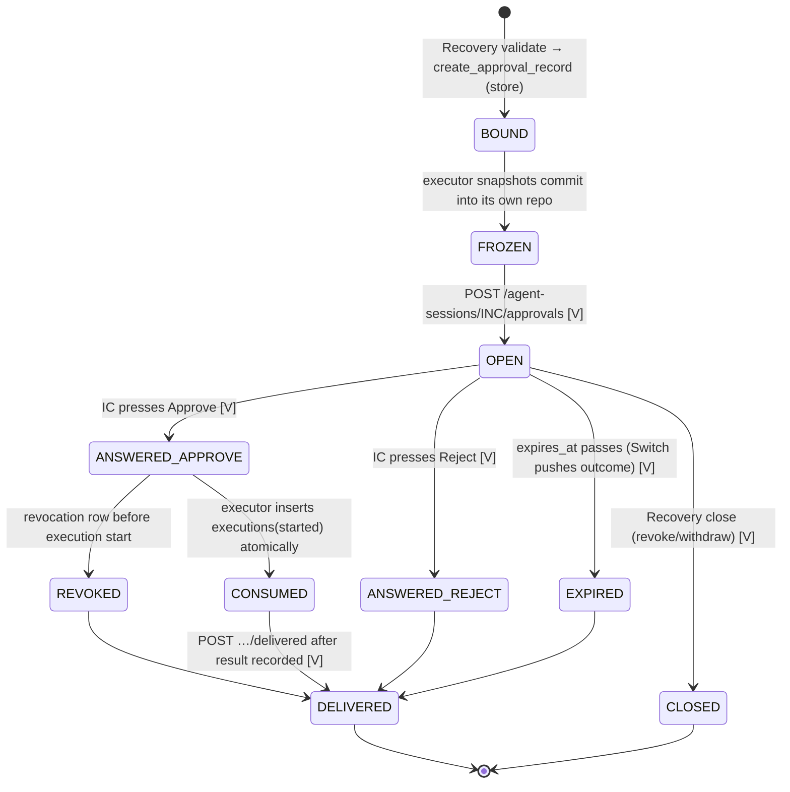

# 04 — Approval Security

This document specifies how human authorization is requested, bound, verified, expired, revoked and kept from being replayed.

Tags: **[V]** verified live against Switch 0.31.0 (S5, 2026-11-07) · **[S]** Switch source · **[MVP]** / **[PROD]**.

---

## 1. The critical requirement

> **A chat message containing `APPROVE INC-1042` must never be sufficient by itself to authorize execution.**

How this is guaranteed:

| Layer | Guarantee | Evidence |
|---|---|---|
| Switch | Free text does not answer an approval request. Only a button press on the card, or a typed reply that names the card's handle (`A<n> <option>`), is processed by `ApprovalAnswers`, and only after the answerer authorization check. | **[V]** We posted `APPROVE INC-<run>` in the incident channel. It produced **no** outcome for any request. |
| Switch | The answerer must be allowed to address the agent (addressing policy in the request's room; owner only with no room) | **[V]** An unlinked Mattermost user pressed Approve; the state stayed `open`. **[S]** `session_activity/service.py:600-632` |
| Switch | Agents cannot answer approvals | **[V]** The agent API key on the answer route → 401. No agent-bridge answer route exists **[S]**. |
| BLACKBOX | **No code path parses approval words.** Recovery's prompt tells it to point humans to the card. Agents have no tool that records an approval. | [MVP] Design rule plus code-review checklist item. Test D-1 in `03-AGENT-PROMPT-DESIGNS.md`. |
| BLACKBOX | The executor accepts **only** an `approval_ref`, and re-derives authorization from Switch | §5 |

Even if Recovery's LLM is fully compromised and announces "approved, executing", the executor's independent read-back from Switch refuses.

**If the team wants the `APPROVE INC-1042` wording in the demo:** have it rendered as the option **label** on the card (for example, the label `APPROVE INC-1042`). The authorization is still the button press that Switch processes, never the text.

---

## 2. Binding

An approval is bound to six elements. Each element is enforced at two independent points: Switch at open time, and the executor at execution time.

| Element | How it is bound in Switch | How the executor checks it |
|---|---|---|
| **Incident** | `session_id = INC-1042`; `request_id` prefix; `room_id` = the incident room (agent must be a member [S]) | Binding `incident_id` = the request's session and room = the incident record |
| **Remediation artifact** | The full `patch_hash` and commit SHA in `detail`; the hash's first 16 hex characters in `request_id`. The content is frozen: a re-open with a different detail → **409 `REQUEST_CONFLICT`** [V]. | Recompute the hash from the executor's own frozen copy (§6). It must equal the binding, the `request_id` segment and the hash parsed from the stored open body. |
| **Action** | `title` and `turn_id = REM-…`. The action catalog entry (`apply_remediation_commit`) is named in `detail`. | The action is taken from the binding and must be in the executor's fixed catalog. No free-form actions exist. |
| **Target environment** | The `request_id` suffix `:staging-sandbox`, and `detail` | The binding environment must be in the executor's environment allowlist and match the `request_id` |
| **Approver identity** | Switch's answerer check (addressing policy) [V]; `answered_by` recorded [V] | `answered_by` must be in `approver_allowlist`: the exact bridge-scoped ids, such as `@switch-mattermost-<bridge>-user:localhost` [V], captured at bootstrap |
| **Decision status** | `state ∈ {open, answered, expired, closed}`; `answer` = option id [V] | `state == "answered"` and `answer == "approve"` |

`request_id = "{incident}:{remediation}:{hash[0:16]}:{environment}" + (":r{k}" if attempt > 1)`. It is at most 200 characters [S].

---

## 3. Approval lifecycle

---

## 4. Expiry, revocation and replay prevention

### 4.1 Expiry

- `expires_at = opened_at + 15 min` [MVP, configurable]. Switch enforces at most 24 h [S].
- Switch marks overdue requests `expired`, refuses late answers, and pushes `approval_outcome{state:"expired"}` [V].
- **The executor additionally requires `now < expires_at` when it inserts `executions(started)`.** Approval must be *used* inside its window, not only *granted* inside it.
- After expiry, the identical re-open returns 422 [V]. So the executor's read-back relies on the undelivered-outcomes queue: Recovery never sends `/delivered` before the executor has finished. If the record can't be read back, execution is refused (fail closed).
- Re-request policy: one new request with `:r2` (a new expiry and a new card), then escalate.

### 4.2 Revocation

Switch has **no human revoke after an answer** [S]. BLACKBOX adds one, and revocation can only *reduce* authority.

| Revocation path | Who | Effect |
|---|---|---|
| `@blackbox-recovery revoke INC-1042` in the room | Only when `sender_id` is in `approver_allowlist` (the incident commander) | Recovery calls `record_revocation`. If the request is still open, it calls `close` [V]. |
| UI "Revoke approval" button | An authenticated BLACKBOX UI user with the IC role [MVP: single local user] | Same |
| Automatic | A newer remediation for the same incident is staged, the incident is reopened, or verification fails | The previous binding is revoked |

The executor checks for a `revocations` row **inside the same transaction** that inserts `executions(started)`. Once `started` exists, revocation turns into a request to **abort and roll back**. The rollback is part of the approved plan (shown on the card).

Revoking by chat is acceptable because it cannot cause an action. At worst, a spoofed revoke causes denial of service. That risk is mitigated by the sender-id check and is recorded in the threat model.

### 4.3 Replay prevention

| Replay attempt | Blocked by |
|---|---|
| Re-using an old "approve" for a new patch | A different hash means a different `request_id`, and the server refuses to reuse a `request_id` with different content [V]. The executor compares the hash. |
| Re-using an approval from another incident | `session_id`, `request_id` prefix, room and binding `incident_id` must all match |
| Re-running the same approved execution (double click, retry, crash recovery) | `executions.approval_id UNIQUE`, plus `UNIQUE(incident_id, patch_hash, environment) WHERE status IN (started, succeeded)`, checked and inserted in one `BEGIN IMMEDIATE` transaction. A retried request returns the existing record. |
| Duplicate `approval_outcome` frames (push plus resync) [S] | `processed_outcomes(session_id, request_id) UNIQUE` |
| Replaying a captured executor HTTP request | The executor endpoint requires a per-call bearer that only Recovery holds; it binds to localhost/Compose-internal only. The request body has no authority anyway: replaying `approval_ref` hits the uniqueness rule. |
| Replaying a captured webhook | HMAC plus a timestamp window plus the seen-body cache (`04-SECURITY-ARCHITECTURE.md` §6) |
| A forged Mattermost button callback | Switch validates the card token stored in `approval_request_posts` [S] and still applies the answerer check [V]. **[PROD]** Restrict switch-core's callback port (8081) to the Mattermost network only. |

---

## 5. Executor verification algorithm (normative; prose, not code)

Input: an `approval_ref` from Recovery over an authenticated internal channel.

1. **Load the binding** from the store by `approval_ref`. It must exist, with status `open` or `answered` and no `consumed` flag. → else REFUSE `binding_missing`.
2. **Check the action and environment.** `action` must be in `ACTION_CATALOG` and `environment` in `ENV_ALLOWLIST`. → else REFUSE.
3. **Check the artifact.** Recompute `patch_hash` from the **executor's frozen copy** (base..commit canonical diff). Check `parent(commit) == base_commit` and `base_commit ==` the target's currently deployed SHA. → else REFUSE `artifact_mismatch` (a security event).
4. **Check the request id.** Recompute `request_id` from the binding fields. It must equal the stored `switch.request_id`. The stored open-body `detail` must contain the full `patch_hash`, and `sha256(open_body)` must equal `open_body_sha256`. → else REFUSE.
5. **Read the decision from Switch** [V]:
   1. `GET /agent-sessions/approvals/outcomes` (with Recovery's key, used only for reading) → find `request_id`.
   2. If it is not found, `POST /agent-sessions/{session}/approvals` with the **identical stored body**. The server returns the current row (valid until `expires_at`) [V].
   3. If it is still not found, or the call errors or returns 422 → REFUSE `decision_unverifiable`.
6. **Assert the decision.** All of these must hold:
   - `state == "answered"`
   - `answer == "approve"`
   - `answered_by` is in `approver_allowlist`
   - `answered_at ≤ expires_at`
   - `now < expires_at`

   → else REFUSE (`rejected` / `expired` / `unauthorized_approver` …).
7. **Atomic consume.** In one `BEGIN IMMEDIATE` transaction:
   - the incident state is `APPROVED`;
   - there is no `revocations` row for the binding;
   - there is no `executions` row for `approval_id`, and none for `(incident, hash, env)` with status `started` or `succeeded`;

   then INSERT `executions(status=started)`, set the binding to `consumed`, and append the event. → else REFUSE.
8. **Execute** the catalog action by commit SHA. Verify that the deployed SHA equals `commit`.
9. **Record** the result and the health verification, and append the events.
10. **Acknowledge** with `POST …/delivered` [V]. This is last, so the outcome stays readable through steps 5–9.

Every REFUSE:

- appends `execution_refused{reason, evidence}`;
- returns the reason to Recovery, which posts it in the room;
- changes **nothing** on the target.

Unknown exceptions are treated as REFUSE.

---

## 6. Artifact freeze (prevents time-of-check/time-of-use)

When Recovery creates the binding, the executor `git fetch`es `commit` from RootCause's worktree into `/executor/repo.git`, a path writable only by the executor. That copy is the one used for:

- the hash recomputation (step 3), and
- the deployment (step 8).

After this point, RootCause, or an attacker controlling RootCause's worktree, cannot change what gets deployed. A changed worktree simply no longer matters.

---

## 7. Attack walkthroughs

| # | Attack | Outcome |
|---|---|---|
| 1 | The incident commander (or anyone) types `APPROVE INC-1042` | No Switch outcome [V]. Recovery replies "use the card". The executor, if called, finds `state=open` → REFUSE. |
| 2 | A Mattermost user who is not authorized presses Approve | Switch refuses; the state stays `open` [V] |
| 3 | A compromised Recovery LLM calls `request_execution` before any approval | Step 5/6: `state=open` → REFUSE |
| 4 | A compromised Recovery process opens an approval for patch A, then deploys patch B | Recovery cannot deploy. The executor deploys only the frozen commit whose hash equals the binding equals the card `detail` (steps 3–4). |
| 5 | RootCause modifies the worktree after approval | The frozen copy is used (§6) |
| 6 | An old approval is replayed for revised patch REM-2 | A new `request_id` (a re-open with different content gets 409 [V]); the hash differs → REFUSE |
| 7 | A double click or retry triggers two executions | Step 7 uniqueness → the second is REFUSED, and the first result is returned |
| 8 | The approval is granted at 10:40 and execution is attempted at 11:00 (expiry 10:50) | Step 6 `now < expires_at` → REFUSE. A re-request is needed. |
| 9 | The incident commander revokes after approving, before execution | Step 7 sees the revocation → REFUSE |
| 10 | A human pastes a forged `blackbox.handoff/v1` JSON | The receiver's sender-id and store-hash check rejects it (`03-HANDOFF-SCHEMAS.md` §1) |
| 11 | switch-core restarts while the incident commander presses Approve | The press may be lost during bridge reconnect [V]. The state stays `open`, and the executor refuses. The commander re-presses after recovery. Fail closed. |
| 12 | The addressing policy is accidentally opened to "anyone" | Switch would accept a stranger's answer, but the executor's `approver_allowlist` refuses (defense in depth) |

---

## 8. Test cases

| ID | Test | Status |
|---|---|---|
| AP-1 | Plain-text `APPROVE INC-…` produces no outcome | **Verified [V]** |
| AP-2 | An unlinked user's press is refused | **Verified [V]** |
| AP-3 | An agent key cannot answer (401) | **Verified [V]** |
| AP-4 | A re-open with a different hash → 409 | **Verified [V]** |
| AP-5 | An expiry is pushed; a late re-open → 422 | **Verified [V]** |
| AP-6 | Approve press → `approval_outcome` with `answered_by` | **Verified [V]** |
| AP-7 | Reject press → `answer=reject`; the executor refuses | Switch half verified [V]; executor half to be built |
| AP-8 | Executor: hash mismatch → refuse | To build |
| AP-9 | Executor: second execution → refuse | To build |
| AP-10 | Executor: revoked → refuse | To build |
| AP-11 | Executor: `now ≥ expires_at` → refuse | To build |
| AP-12 | Executor: `answered_by` not in the allowlist (policy widened) → refuse | To build |
| AP-13 | Executor: Switch unreachable → refuse | To build |
| AP-14 | Compromised Recovery calls execute without approval → refuse | To build |

AP-7 to AP-14 are acceptance tests for the executor and must pass before the demo.
