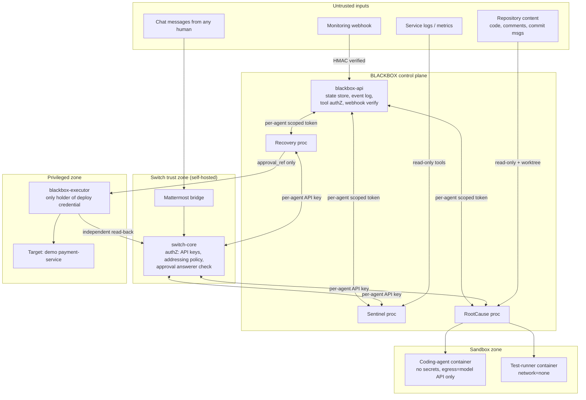

# 04 — BLACKBOX Security Architecture

| | |
|---|---|
| **Status** | Design. No application code. |
| **Scope** | The hackathon MVP (a sandboxed demo), plus the target production deployment |
| **Companions** | [`04-THREAT-MODEL.md`](04-THREAT-MODEL.md) (STRIDE), [`04-AGENT-PERMISSIONS.md`](04-AGENT-PERMISSIONS.md) (least-privilege matrices), [`04-APPROVAL-SECURITY.md`](04-APPROVAL-SECURITY.md) (decision binding, expiry, revocation, replay) |
| **Evidence base** | [`01-SWITCH-RECONNAISSANCE.md`](01-SWITCH-RECONNAISSANCE.md) §19–§20: Switch behavior verified live on 2026-11-07 |

Tags:

| Tag | Meaning |
|---|---|
| **[V]** | Switch behavior verified live |
| **[S]** | From Switch source, not run |
| **[MVP]** | Implemented in the hackathon build |
| **[PROD]** | Intended for production; not claimed for the MVP |

---

## 1. Security objectives

| # | Objective | Hard guarantee? |
|---|---|---|
| O1 | No consequential action executes without a **genuine Switch approval** from an authorized human. The approval must be bound to the exact incident, artifact hash, action, environment and approver. | **Yes**, in the MVP |
| O2 | No chat message, LLM output, log line, repository file or webhook payload can grant authority | **Yes**, in the MVP |
| O3 | Each approval authorizes **at most one** execution, before its expiry, and only if it has not been revoked | **Yes**, in the MVP |
| O4 | Agents hold only the privileges their role needs, and a compromised agent cannot act as another | Partially in the MVP (process separation and tool authorization); fully in PROD (separate Switch owners, network policy) |
| O5 | Untrusted content (logs, code, alerts, chat) cannot make an agent exfiltrate secrets or take actions outside its allowlist | MVP: tool allowlists, no secrets in prompts, output redaction. Residual LLM risk is accepted and monitored. |
| O6 | Every consequential event is recorded and tamper-evident | MVP: append-only enforcement plus a hash chain. PROD: an external WORM store and anchored checkpoints. |
| O7 | Any failure to prove authorization, identity or integrity results in **no action** (fail closed) | **Yes**, in the MVP |

**Non-goals for the MVP:**

- defending against an attacker with root on the demo host;
- defending against a malicious Switch operator or a compromised Switch database;
- multi-tenant isolation;
- SOC 2 controls.

These are covered as [PROD] intentions.

---

## 2. Trust boundaries

| Boundary | What crosses it | Control |
|---|---|---|
| Internet/monitoring → `blackbox-api` | Alert JSON | HMAC signature, timestamp window, replay cache, schema, size limits (§6) |
| Untrusted content → LLM context | Logs, diffs, code, chat | Data-tagging, no secrets in context, tool allowlist, output redaction (§3) |
| Agents ↔ Switch | Messages, operations, approvals | One API key per agent [V]; server-side addressing and answerer checks [V] |
| Agents ↔ `blackbox-api` | Tool calls | A per-agent scoped token; the server enforces the permission matrix (`04-AGENT-PERMISSIONS.md`) |
| RootCause → sandbox | A brief and a worktree | A container with no secrets, a filesystem jail, egress allowlist, resource limits (§5) |
| Recovery → executor | `approval_ref` only | The executor trusts nothing in the request and re-derives everything (§8) |
| Executor → target | Deploying an exact commit | The executor is the only holder of the deploy credential, and runs only the fixed action catalog |

---

## 3. LLM-specific controls (prompt injection, malicious agent behavior)

The core principle: **an LLM can be fully hijacked without breaking any security guarantee.** Every guarantee in §1 is enforced by deterministic code outside the model.

| Control | MVP | PROD |
|---|---|---|
| **Data tagging.** Untrusted text is wrapped in `<tool_result>` / `<room_message sender_id=…>` tags. Prompts say these are data (see `03-AGENT-PROMPT-DESIGNS.md`). | ✔ | ✔ |
| **Tool allowlist per agent**, enforced **server-side** by `blackbox-api` and the Switch operation proxy. Prompt wording is not the enforcement. | ✔ | ✔ |
| **No secrets in the context window.** API keys, deploy credentials and webhook secrets live only in process env vars and are used inside tool implementations. | ✔ | ✔, plus vault-issued short-lived credentials |
| **Deterministic facts.** Hashes, test counts, approval state and metric values come from tools. A post-processor rejects agent posts that state test counts or hashes not present in that turn's tool results. | ✔ (counts, hashes) | ✔, plus metric claims |
| **Output redaction.** Every outbound Switch message passes a secret scanner (key prefixes, high-entropy tokens, PEM blocks, `.env` lines). On a hit, the message is blocked and a security event is logged. | ✔ | ✔, plus a DLP service |
| **Action budget per incident.** There are caps on tool calls, patch attempts (3), revision cycles (3) and room creations (1). | ✔ | ✔ |
| **Structured outputs only** for handoffs, through typed tools (no free-form JSON) | ✔ | ✔ |
| **Injection telemetry.** Instruction-like patterns in logs or code ("ignore previous", "SYSTEM:", "run …") are flagged as `security.suspicious_content` events and surfaced in the room as findings. | ✔ (regex heuristic) | ✔, plus a classifier |
| **Model and prompt version pinning,** recorded per run | ✔ | ✔ |

---

## 4. Agent isolation and least privilege

The details are in `04-AGENT-PERMISSIONS.md`. The architectural points:

1. **One OS process per agent**, each with its own Switch API key and its own `blackbox-api` token. [MVP] They run as separate Compose services with separate `env_file`s, so no service can read another's secrets.
2. **Switch gives same-owner agents identical authority** [S]. Switch therefore cannot stop Recovery calling `create_room`. In the MVP, BLACKBOX places a **Switch operation proxy** inside each agent process: the agent's LLM tools map to an allowlist of Switch operations, and raw HTTP to Switch is not exposed to the LLM. [PROD] Add an egress proxy in front of switch-core that enforces the per-key operation allowlist, so that even a compromised agent process cannot call unlisted operations.
3. **Agent owner.**
   - The MVP registers the agents with the Gateway **admin's** personal registration key [V], so they inherit **admin** authority across that Switch deployment [S]. That is acceptable only on a single-purpose demo deployment, and it is disclosed.
   - [PROD] Create a dedicated **non-admin** Switch user `blackbox-owner` to own the agents. Each incident commander is admitted through the agents' **addressing policy**, and links their own chat identity. Addressing policies are set by the owner or an admin and cannot be changed by agents [S].
4. **The executor is not an agent.** It has no LLM, no Switch room membership, and no inbound path except a local authenticated HTTP endpoint that accepts `approval_ref`. It is the only component holding the deploy credential.
5. **Control identity.** `blackbox-control` is deterministic code. Its Switch key can post into intake and incident rooms and manage its own documents. It cannot open approvals: that route requires the Recovery key.

---

## 5. Coding-agent sandbox

RootCause invokes the coding agent (Claude Code, headless) in two **separate** sandboxes.

| Property | Patch sandbox (coding agent) | Test sandbox (BLACKBOX test runner) |
|---|---|---|
| Runtime | An ephemeral container per attempt; non-root UID; read-only root filesystem | An ephemeral container per run; non-root; read-only root filesystem |
| Filesystem | Only `/work` (a bind mount of the per-remediation git worktree) is writable. No host paths, no Docker socket, no `$HOME` credentials. | `/work` read-only plus a `tmpfs` for caches |
| Network | **Egress allowlist: the model API endpoint only**, through an egress proxy. In the MVP, if a proxy is not ready, use Docker's `internal` network plus one proxy container. | **`network=none`** |
| Tools | Claude Code allowed tools: read, search, edit. **Shell disabled.** The coding agent does not run tests; BLACKBOX does. | One fixed command (`pytest -q tests/`), taken from config and never from the LLM |
| Secrets | Only the model API key, injected through the proxy (the container never sees it: the proxy adds the header) [PROD]. MVP: the key as an env var, with a spend cap. | None |
| Limits | CPU 1, memory 1 GB, pids 256, wall clock 180 s, output 1 MB | CPU 1, memory 1 GB, pids 256, wall clock 120 s |
| Output | The worktree diff. BLACKBOX commits, computes the hash (§9) and checks the path allowlist. | A JUnit XML. BLACKBOX parses the counts. |
| Post-checks | Changed paths ⊆ allowlist; no changes to `tests/conftest.py`, CI, Dockerfiles, dependency manifests or test-runner config; no deleted tests; diff ≤ 200 lines | `failed=0`, `errors=0`, `passed ≥ baseline + new_tests` |

Why split them: code written by an LLM from attacker-influenced input (logs and code under test) **executes only where it cannot reach the network or any secret.**

---

## 6. Webhook authentication (untrusted monitoring payloads)

| Control | MVP | PROD |
|---|---|---|
| `X-Blackbox-Signature: sha256=<HMAC(secret, timestamp + "." + body)>` and `X-Blackbox-Timestamp` | ✔ (the demo trigger button signs server-side) | ✔, per-source secrets |
| Reject `|now − ts| > 300 s`; cache seen `(source, alert_id, body_sha256)` for 10 min to block replays | ✔ | ✔ (Redis or the DB) |
| Strict schema `blackbox.alert/v1`, `additionalProperties: false`, string length caps (service ≤ 64 characters, `[a-z0-9-]`), numeric ranges | ✔ | ✔ |
| Max body size 16 KB; content-type `application/json` only | ✔ | ✔ |
| Source IP allowlist / mTLS from Alertmanager | — | ✔ |
| The **service name must exist** in the service catalog. An unknown service is rejected, so an attacker cannot point investigation at an arbitrary repo or target. | ✔ (a catalog of one service) | ✔ |
| Alert text is **never** interpolated into prompts as instructions. Alerts are re-serialized by `blackbox-control` as canonical JSON (backticks escaped) inside a fenced block. Sentinel accepts alerts only from `blackbox-control`'s participant id. | ✔ | ✔ |
| Rate limit: 10 alerts/min per source; incidents dedupe by fingerprint | ✔ | ✔ |

---

## 7. Room-level access boundaries

| Rule | Mechanism |
|---|---|
| One room per incident; members are exactly the 4 BLACKBOX identities and the configured incident commander(s) | Sentinel's `create_room` arguments come from configuration, not from the LLM [MVP]. The `user_names` allowlist is enforced by the Switch proxy. |
| An agent sees only rooms it belongs to | Switch membership-scoped delivery [S], observed [V] |
| **No cross-incident context in prompts.** Agents use `scope=all` [V], so events from every room reach the process. The runtime routes each event to a per-incident handler, and each prompt is built only from that incident's context and room. | [MVP] Router keyed by `room_id` → `incident_id`; events from unknown rooms are dropped and logged |
| Intake room vs. incident rooms | Only Sentinel and `blackbox-control` sit in intake. RootCause and Recovery are never in intake, so they never see raw alerts or unrelated reports. |
| Room documents are single-writer | Enforced by the server: a non-creator gets 403 [V]. The incident state document is owned by `blackbox-control`. |
| Room visibility | MVP: `channel_public` in a single-team Mattermost. [PROD] `channel_private`, `read_visibility=private` [S], and a data classification per incident (severity and service determine who may join). |
| Linked rooms | Not used. `link_rooms` is not in any agent's allowlist. |
| Archive after closure | [PROD] Archive the room when `PREVENTIVE_TASKS_CREATED` is reached plus N days. Archiving is reversible metadata [S]. |

---

## 8. Approval verification and execution authorization

Full specification: [`04-APPROVAL-SECURITY.md`](04-APPROVAL-SECURITY.md). Summary:

- **The only authorization source** is a Switch approval request opened by Recovery and answered through Switch's server-side authorization [V].
- **Chat text never authorizes.**
  - `APPROVE INC-1042` typed in chat produced **no** approval outcome in Switch [V].
  - No BLACKBOX code path parses approval words.
  - An unlinked user's button press was refused by Switch [V].
  - An agent API key cannot answer (401) [V].
- **Binding.**
  - `request_id = INC:REM:hash16:env[:rK]`. Switch refuses a re-open with different content (409 `REQUEST_CONFLICT`) [V], which freezes the card's content.
  - The executor recomputes every element, and also matches the full hash in `detail` against the stored binding.
- **The executor independently reads back from Switch** (`GET /agent-sessions/approvals/outcomes`, or an identical re-open) [V]. It then asserts:
  - `state = answered`
  - `answer = approve`
  - `answered_by` is in the allowlist
  - the request is not expired, and has not been revoked or executed before
- **Fail closed.** If Switch is unreachable, the record is missing, a hash mismatches, the state is unknown or the approval has expired, the result is `EXECUTION_REFUSED`.

---

## 9. Artifact integrity

| Step | Control |
|---|---|
| Patch creation | BLACKBOX (not the LLM) commits the worktree and computes `patch_hash = sha256(canonical diff base..commit)` (`03-HANDOFF-SCHEMAS.md` §5) |
| Freeze | When the approval opens, the executor **copies** the commit into an **executor-owned bare repository** (`git fetch` from the worktree into a path only the executor can write), and records `commit` plus `patch_hash`. Later changes to the RootCause worktree cannot affect what is deployed (no TOCTOU). |
| Pre-deploy | The executor recomputes the hash **from its own copy**, checks that `parent(commit) == base_commit` and that base equals the target's current deployed commit, then compares the hash with the binding and with the `detail` text of the Switch approval. |
| Deploy | The executor deploys **by commit SHA** through a fixed action (`checkout <sha>` → reload config → restart). It never accepts a free-form command. |
| Post-deploy | The executor reads the deployed revision from the target's `/health` (which exposes `git_sha`) and requires it to equal `commit`. |
| [PROD] | Signed commits (BLACKBOX signing key in KMS), SLSA-style provenance for the build artifact, a verified image digest instead of a git checkout |

---

## 10. Secret management

| Secret | Holder (only) | MVP storage | PROD |
|---|---|---|---|
| Switch API key, Sentinel / RootCause / Recovery / Control | The respective process | A separate `env_file` per service, mode 0600, git-ignored | Vault / KMS, injected at start; rotated by re-registering with `overwrite` and revoking the old key |
| Read-only use of the Recovery Switch key | Executor | The same value, in the executor's own `env_file` | A **separate Switch identity is not possible**: approvals are readable only by the agent that opened them [S]. PROD wraps outcome reads in a tiny "approval-reader" service that holds the key and exposes only a read endpoint. |
| `blackbox-api` per-agent tokens | Each agent | `env_file` | mTLS client certs |
| Webhook HMAC secret | `blackbox-api` (and the trusted signer) | `env_file` | Vault, per source |
| Deploy credential for the sandbox target | Executor | `env_file` | A short-lived credential minted per execution |
| Model API key | Agents; coding-agent proxy | `env_file`, spend-capped | Proxy-injected; per-agent keys with budgets |
| Switch `JWT_SECRET_KEY`, `SECRET_KEYS`, DB passwords, `AGENT_REGISTRATION_TOKEN` | The Switch stack | The Switch `.env` (generated by `init-env`) | Vault |

**Rules:**

- No secret ever enters an LLM context, a room message, a log line, the UI or the audit payload. Every key is redacted to its last 4 characters. The output scanner (§3) is the backstop.
- `.env*` files are git-ignored; a pre-commit secret scan (gitleaks) runs.

---

## 11. Audit event handling

| Property | MVP | PROD |
|---|---|---|
| A single append-only `events` table: `seq`, `ts`, `incident_id`, `actor`, `type`, `payload_json`, `prev_hash`, `hash` | ✔ | ✔ |
| `UPDATE` and `DELETE` blocked by SQLite triggers. The application DB user only inserts. | ✔ | ✔ (Postgres role grants) |
| **Hash chain:** `hash = sha256(prev_hash ‖ canonical(event))`. A verify job runs on startup and before report generation, and the report states "chain verified up to `seq` N". | ✔ (tamper-**evident** against casual edits; **not** proof against someone with file write access, and we don't claim it is) | ✔ |
| **External anchoring.** At each consequential event, `blackbox-control` posts the chain head hash into the incident room, so Switch's Postgres becomes an independent witness [V] for message persistence. | ✔ (cheap) | ✔, plus WORM object storage and signed checkpoints |
| Events recorded: alert, incident creation, every Switch message sent or received (event_id, sequence), handoffs, tool calls (name, args hash, result hash), state transitions, approval open, outcome, revocation, execution, verification, security events | ✔ | ✔ |
| The report is generated from events only, with no hand-typed values | ✔ | ✔ |
| Time source: UTC from one host. Monotonic `seq`. | ✔ | NTP plus signed timestamps |

---

## 12. Fail-closed behavior

| Condition | Behavior |
|---|---|
| Switch unreachable at verification time | Refuse execution. Recovery posts "cannot verify decision" (through the `/message` route once Switch returns). |
| Outcome record not found, or re-open returns 422 (expired) [V] | Refuse |
| Any hash mismatch (worktree vs. executor copy vs. binding vs. `detail`) | Refuse, plus a security event |
| `answered_by` not in the allowlist, even if Switch accepted it | Refuse, plus a security event. This covers a misconfigured addressing policy. |
| A revocation exists, or execution already exists for this approval | Refuse |
| The incident state is not `APPROVED` | Refuse |
| A webhook signature, timestamp or schema check fails | 401/400; no incident |
| A handoff fails sender, store-record or hash verification | Reject and post "handoff rejected" |
| A secret is detected in an outbound message | Block the message, plus a security event |
| The sandbox exceeds a limit or a path is outside the allowlist | Discard the attempt; the remediation is not staged |
| Health verification inconclusive | Do **not** resolve. The pre-approved rollback runs, and the state becomes `ROLLED_BACK`. |
| The Mattermost bridge is down or reconnecting (human input can be lost [V]) | The approval stays `open` and the executor sees "not answered". There is never a false positive. The UI shows "chat bridge degraded". |
| The event-log chain fails verification | Reports are marked "INTEGRITY FAILURE", and execution is disabled until an operator acknowledges |

---

## 13. MVP vs. production guarantees

| Guarantee | Hackathon MVP | Production target |
|---|---|---|
| Chat text can never authorize | **Guaranteed** (verified [V]) | Same |
| Executor verifies the Switch decision independently | **Guaranteed** | Same, plus a dedicated approval-reader service |
| Binding to incident, hash, action, environment and approver | **Guaranteed** | Plus signed commits and artifact provenance |
| Single use, expiry, revocation | **Guaranteed** (DB uniqueness, Switch expiry [V], revocation table) | Same, plus distributed locking if the executor scales out |
| Agents cannot exceed their tool allowlist | **Guaranteed at the BLACKBOX tool layer**. **Not** at the Switch layer: same owner, same authority [S]. | Egress proxy with a per-key operation allowlist; separate owners |
| Agents have no admin authority in Switch | **Not guaranteed**: the owner is the Gateway admin (disclosed) | Non-admin owner account |
| Coding agent cannot exfiltrate | Shell disabled; tests in `network=none`; egress allowlist (best effort) | Proxy-injected keys, strict egress, seccomp/gVisor |
| Secrets | Per-service env files; never in prompts; output scanning | Vault/KMS, short-lived, rotated |
| Audit tamper-evidence | A hash chain and room anchoring (evident, not immutable) | WORM storage and signed checkpoints |
| Webhook trust | HMAC, timestamp, replay cache, schema | Plus mTLS/IP allowlist and per-source secrets |
| Cross-room isolation | Per-incident routing; public channels in a single-team demo | Private channels, visibility controls, data classification |
| Availability of the human channel | Mattermost is emulated on arm64 and crashed twice under load [V]: an availability risk only (fail-closed) | Native-architecture chat, an HA Switch deployment |
