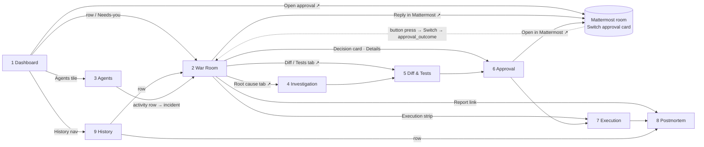
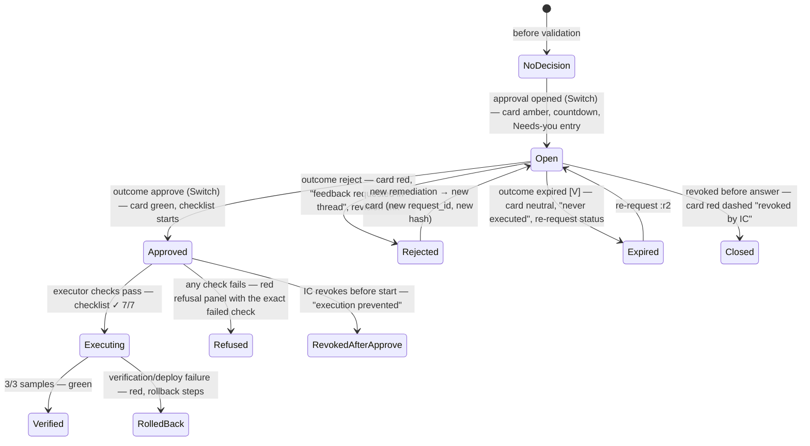

# 06 — Screen Flows

Navigation, routes, and how UI state follows the incident lifecycle. Screen details are in [`06-UX-SPECIFICATION.md`](06-UX-SPECIFICATION.md); styling is in [`06-DESIGN-SYSTEM.md`](06-DESIGN-SYSTEM.md).

## 1. Routes and navigation map

| Route | Screen |
|---|---|
| `/dashboard` | 1 · Incident Command Dashboard (default) |
| `/incidents/:id` | 2 · Live Incident War Room |
| `/agents` | 3 · Agent Activity Monitor |
| `/incidents/:id/investigation` | 4 · Investigation and RCA |
| `/incidents/:id/remediation/:rid` | 5 · Code Diff and Tests |
| `/incidents/:id/approval` | 6 · Human Approval Interface |
| `/incidents/:id/execution` | 7 · Recovery Execution Monitor |
| `/incidents/:id/report` | 8 · Postmortem |
| `/history` | 9 · Incident History |
| *external* `mattermost/<team>/channels/<room>` | The real Switch room, where humans talk and decide |



Every incident sub-screen shares a sub-header (the incident ID, state chip and live indicator) and a tab row: **War room · Investigation · Remediation · Approval · Execution · Report**. Tabs that are not yet relevant are visible but disabled, with a tooltip saying why (for example "No remediation staged yet").

---

## 2. Lifecycle → UI state mapping

| Incident state(s) | Header chip | Primary call-to-action | Auto-focus tab (war room right panel) | Strip color |
|---|---|---|---|---|
| DETECTED / INVESTIGATING | ◐ Investigating | — | Root cause | neutral |
| NEEDS_HUMAN | ✋ Needs human (amber solid) | "Respond in Mattermost ↗" (the question is shown) | Root cause (with gaps) | amber |
| ROOT_CAUSE_IDENTIFIED / REMEDIATION_STAGED / VALIDATING | ◐ Remediating | — | Diff → Tests | neutral |
| AWAITING_APPROVAL | ◆ Awaiting approval | **"Open approval card ↗"** plus the countdown | Approval | amber |
| APPROVED / EXECUTING / VERIFYING | ◐ Executing | "View execution" | Approval (checklist) → Execution | blue |
| RESOLVED → PREVENTIVE_TASKS_CREATED | ✓ Resolved | "View postmortem" | — | green |
| REJECTED / NEEDS_REVISION / REVOKED | ↺ Revising | — | Diff (new attempt) | amber |
| APPROVAL_EXPIRED | ◆ Re-requesting | "Open new card ↗" | Approval | amber |
| ROLLING_BACK / ROLLED_BACK | ↶ Rolled back | "View execution" | Execution | red |
| FAILED | ▲ Failed | "Operator: reset" (operator only) | Execution | red |

**Auto-focus rule:** the right panel switches tab automatically only if the user hasn't selected a tab in the last 60 s. Otherwise a small "New: Approval ◆" pill appears on that tab. The UI never takes control away from the user.

---

## 3. Primary flow: happy path (demo)

```mermaid
sequenceDiagram
  autonumber
  actor IC as Incident Commander
  participant UI as BLACKBOX UI
  participant API as blackbox-api (SSE)
  participant MM as Mattermost (Switch room)
  IC->>UI: /dashboard — HEALTHY, clicks TRIGGER PAYMENT INCIDENT
  UI->>API: POST /sim/trigger (preconditions checked)
  API-->>UI: SSE metrics turn red; then incident INC-1042 created
  UI-->>IC: "Needs you" empty; Active incidents row appears ◐
  IC->>UI: opens War Room
  API-->>UI: Switch events stream in (Sentinel msg, HANDOFF card SN→RC, RC milestones, HANDOFF RC→RV)
  API-->>UI: Decision card (Switch approval A1, ◆ open, countdown)
  UI-->>IC: Strip amber; Approval tab pill; Needs-you on dashboard
  IC->>UI: Approval tab → reviews binding, diff, tests
  IC->>MM: Open in Mattermost ↗ → presses Approve on card A1
  MM-->>API: (via Switch → Recovery → API) outcome answered/approve
  API-->>UI: Decision card turns green "answered by user · 10:41:12Z · via button"
  API-->>UI: Executor steps stream: 7/7 checks ✓, deploy #843, verify 1/3 → 3/3
  UI-->>IC: Charts drop; before/after tiles; header ✓ Resolved
  API-->>UI: Report ready; preventive tasks rows
  IC->>UI: View postmortem
```

---

## 4. Decision flows

### 4.1 Approve / reject / expire / revoke (UI behavior)



### 4.2 Typed-approval attempt (teaching moment)

1. A human types `APPROVE INC-1042` in Mattermost. It arrives as a **human message row** in the war-room feed [V].
2. The feed shows an inline note on that row: *"Chat text does not authorize. Decisions use the approval card."*
3. Recovery's reply row follows.
4. The decision card stays ◆ open. No state change.

### 4.3 Revoke (UI-initiated)

1. On the Approval screen, the IC clicks **Revoke…**.
2. A modal explains the effect and asks for an optional reason.
3. Confirming calls `POST /api/incidents/:id/approvals/:aid/revoke` (IC role only).
4. The feed shows a BLACKBOX revocation row, then Recovery's close of the card (a Switch event), then the state divider `→ REVOKED`.

---

## 5. Failure flows (what the user sees)

| Flow | Trigger | Screens involved | UI sequence |
|---|---|---|---|
| **A · No evidence** | Sentinel finds nothing | War room → Investigation | A Sentinel row with "insufficient evidence, widening" → gaps panel → header ✋ Needs human → Needs-you entry "Answer Sentinel's question in Mattermost ↗" |
| **B · Tests fail** | Red test run | War room → Diff & Tests | An RC milestone row `TESTS_RESULT 26/27 ✗` → attempt tab 1 red, failures expanded → attempt 2 in progress → (if all fail) banner "NOT VALIDATED", ✋ Needs human with the options |
| **C · Rejected** | IC presses Reject | War room → Approval → Diff | The decision card goes red → Recovery's thread question row → a revision handoff card RV → RC (red-violet chips) → new attempt → new decision card |
| **Deploy fails** | Launcher error | War room → Execution | Executor rows "Deploying…" then "Launcher reverted to C5" → header ↶ Rolled back → strip red |
| **No recovery** | Verification 0/3 after 60 s | Execution | The samples table shows failing criteria; rollback steps; never "Resolved" |
| **Executor refuses** | Any failed check | Approval → Execution | The refusal panel names the check; a security-event row in the feed |
| **Bridge degraded** | Mattermost/bridge reconnecting [V] | Every screen | A global amber banner; the decision card notes "clicks may not reach Switch right now" |
| **Stream lost** | SSE drop | Every screen | An amber banner, auto-reconnect, backfill by `after_seq`, then "Caught up (14 events)" |

---

## 6. Operator flows

| Flow | Entry | Steps |
|---|---|---|
| **Demo reset** | Dashboard ⋯ menu → "Reset demo" (operator role) | Confirm modal listing what will be archived → a progress list mirroring `05-SIMULATION-ARCHITECTURE.md` §17 (quiesce, Switch cleanup, Mattermost restart, repo rebuild, …, warm-up 3/3) → "READY" with the pinned SHAs. The history page shows the archived run. |
| **Presenter mode** | Top bar user menu | Scale 1.15, hide secondary metadata, enlarge the decision card and before/after tiles, hide the agent activity table |
| **Raw event inspection** | Any provenance badge | A drawer with the Switch event JSON (`event_id`, `sequence`, `sender`, `addressed`) or the BLACKBOX event JSON, and its hash-chain position |

---

## 7. Notifications and attention management

| Event | In-app signal | Sound |
|---|---|---|
| A new decision requires the IC | Needs-you entry, decision card, tab pill, browser title prefix `◆ (1)` | None (Mattermost notifies the human natively) |
| Expiry under 5 min | Countdown amber; under 1 min red | None |
| NEEDS_HUMAN | Needs-you entry, ✋ chip | None |
| Execution refused, rollback, integrity failure | A red banner on incident screens; feed row | None |
| Routine agent progress | Feed only | None |

There are no toasts for system events; toasts are reserved for confirming the user's own actions.

---

## 8. Keyboard map

| Key | Action |
|---|---|
| `g d` / `g h` / `g a` | Go to Dashboard / History / Agents |
| `g i` | Go to the most recent active incident |
| `j` / `k` | Next / previous feed row |
| `Enter` | Open the focused row's detail drawer |
| `f` | Focus the feed filter |
| `g l` | Jump to the live end of the feed |
| `1`–`5` | War-room right-panel tabs |
| `c` | Copy the focused hash or ID |
| `?` | Shortcut help |
