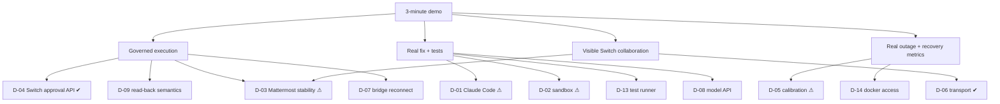

# 07 — Dependency Risk Register

**Scoring:** Likelihood (L) and Impact (I) each run 1–5. Score = L × I.

| Band | Score |
|---|---|
| ≥ 15 | **High** |
| 8–14 | **Medium** |
| ≤ 7 | **Low** |

**Status values:**

| Status | Meaning |
|---|---|
| Open | Unmitigated |
| Spiking | A spike is planned or running |
| Mitigated | Controls are designed |
| Retired | Proven, or no longer applicable |

**Evidence tags:**

| Tag | Meaning |
|---|---|
| [V] | Observed live |
| [H] | From CLI help text |
| [S] | From source |

---

## 1. Top five highest-risk technical dependencies

| Rank | ID | Dependency | Why it is high risk | Score |
|---|---|---|---|---|
| 1 | D-01 | **Claude Code headless as RootCause's coding engine** | Not yet exercised [H only]. Its reliability, latency, cost and tool-restriction enforcement all directly determine the demo's centerpiece (0:55–1:30). | L4 × I5 = **20** |
| 2 | D-02 | **Coding-agent sandbox containment** (read-only container, egress allowlist) | Unproven assumptions: the CLI's behavior under a read-only rootfs and through an HTTPS proxy. A failure forces either weaker isolation or a broken coding path. | L3 × I5 = **15** |
| 3 | D-03 | **Mattermost (amd64-only) on the arm64 demo host** | Hung 3 times under load [V]. When the human channel is down, no approval can happen (fail-closed), so the demo stalls. | L4 × I4 = **16** |
| 4 | D-04 | **Switch approval-request API as the "decision" primitive** | Proven end to end [V], but undocumented for this use, built for Console session hosts, and recently added (its design doc still says "not merged"). An upgrade could change it. The whole governance story depends on it. | L2 × I5 = **10** at the pinned version; **20** if Switch is upgraded unpinned |
| 5 | D-05 | **Simulation calibration on a constrained host** | The outage must be measured and not scripted. CPU contention with emulated Mattermost could push the numbers outside the ranges, or make them noisy. | L3 × I4 = **12** |

---

## 2. Full register

| ID | Dependency | Type | L | I | Score | Evidence | Mitigation | Early-warning trigger | Contingency | Owner | Status |
|---|---|---|---|---|---|---|---|---|---|---|---|
| D-01 | Claude Code headless (`claude -p`) | External tool and LLM | 4 | 5 | 20 | Flags present [H]; no run yet | SP-1; a pinned CLI version; tight briefs; `--max-budget-usd`; `stream-json` audit; timeouts | SP-1 success rate < 4/5 or p50 > 60 s | The deterministic fallback patch (labelled SIMULATED) becomes primary; Claude Code best effort | RootCause owner | Spiking |
| D-02 | Container sandbox and egress proxy for the coding agent | Infra / security | 3 | 5 | 15 | Design only | SP-2; tmpfs `$HOME`; `cap-drop ALL`; `no-new-privileges`; tool restriction as a second layer | The CLI fails on a read-only rootfs or ignores `HTTPS_PROXY` | A host firewall allowlist instead of a proxy; record residual T-23b | Platform | Spiking |
| D-03 | Mattermost 11.9 emulated on arm64 | Environment | 4 | 4 | 16 | 3 hangs with Go panics [V] | SP-7 with ≥ 4 CPU / 6 GB; restart in reset; pre-create the room before recording | Any panic during the soak; ping p99 > 500 ms | Record on an amd64 cloud VM; Rosetta emulation | Demo owner | Open |
| D-04 | Switch approval-request API | External platform (undocumented) | 2 | 5 | 10 | S5 [V]: card, answerer check, 409, expiry, outcomes | Pin images to `0.31.0`; L4 integration suite gates upgrades; executor fail-closed | L4 failures after any Switch change | Fallback (disclosed): a Console-hosted Claude Code Recovery whose native approval prompt produces the card (more complex) | Integration | Mitigated |
| D-05 | Calibration of outage physics | Simulation | 3 | 4 | 12 | Analytical model only | SP-5; the 60 rps × 200 ms profile; resource budget (`05-SIMULATION-ARCHITECTURE.md` §18) | Ranges missed in SP-5 | Lower-rate profile; widen the ranges; never script the numbers | Sim owner | Spiking |
| D-06 | Switch transport mid-migration (WebSocket primary, SSE deprecated) | External platform | 2 | 3 | 6 | Code and artifacts revision notes [S]; WebSocket proven [V] | A single `SwitchConnection` adapter; the pinned version | A refused or changed WebSocket frame shape in L4 | SSE plus beat fallback, still served [S] | Integration | Mitigated |
| D-07 | Mattermost bridge drops human input during a switch-core restart | External platform | 2 | 4 | 8 | S6 restart finding [V] | Never restart mid-flow; wait for the bridge's "authentification OK" log; UI banner; fail-closed approvals | Bridge reconnect logs during a demo | Re-press after recovery; the watchdog nudges the incident commander | Demo owner | Mitigated |
| D-08 | Model API availability, rate limits, latency | External SaaS | 2 | 4 | 8 | — | Spend caps; retries; pre-warmed rehearsal; deterministic fallback for coding; short agent prompts | 429/5xx in rehearsal | Fallback patch; Recovery and Sentinel narratives degrade to templated text (labelled) | All agents | Mitigated |
| D-09 | Approval read-back semantics (`/delivered` ordering, expiry 422) | External platform | 2 | 4 | 8 | 422 after expiry [V]; queue semantics [S] | SP-4 V-6/V-10; never `/delivered` before execution | SP-4 surprises | The executor keeps its first verified outcome copy and requires a re-read at consume time | Executor | Spiking |
| D-10 | Single Switch owner who is the Gateway admin (agents inherit admin) | Security posture | 3 | 3 | 9 | Ownership model [S]; bootstrap [V] | E2 operation proxy; disclosed; PROD non-admin owner | — | Create a non-admin owner and set the addressing policy (needs the Gateway policy API, UNKNOWN) | Security | Mitigated (MVP accepted) |
| D-11 | Codex as an alternative coding agent | External tool | 5 | 1 | 5 | Not installed on the host | Not needed for the MVP | — | P2 | — | Deferred |
| D-12 | Switch Tasks | External platform | — | — | — | Absent [V] | Custom BLACKBOX tasks | — | — | — | Retired (replaced) |
| D-13 | Python test-runner image and dependencies offline | Build | 2 | 3 | 6 | — | SP-3; bake the dependencies into the image | A test needs network | Vendor the dependencies | RootCause owner | Spiking |
| D-14 | Docker access from BLACKBOX for sandboxes (socket exposure) | Security / infra | 3 | 4 | 12 | Design | Only the sandbox launcher service mounts the Docker socket; agents and the executor never do. [PROD] Rootless Docker or a microVM runner. | — | Run the sandboxes via a separate rootless Docker context | Platform | Open |
| D-15 | Demo time budget: coding agent plus tests within about 35 s on screen | Product | 4 | 3 | 12 | — | SP-1 timing; pre-warm; a small brief | SP-1 p50 > 45 s | A marked time skip in the edit; never fake output | Demo owner | Spiking |
| D-16 | Room naming after archive (reuse of `incident-payment-service-1042`) | External platform | 3 | 2 | 6 | UNKNOWN | Reset archives the previous room | A collision error in rehearsal | A run-suffix name (`…-1042-b`) | Sim owner | Open |
| D-17 | Addressing policy changes via the Gateway (needed for V-9 and PROD owners) | External platform | 3 | 2 | 6 | Docs say "set from the Gateway" [S]; API path UNKNOWN | Discover it during SP-4 | — | Set it manually in the Gateway UI | Integration | Spiking |

---

## 3. Dependency map

✔ proven at the pinned version · ⚠ top-five risk

---

## 4. Go / no-go gate for full implementation

Start full MVP implementation when all of these hold:

1. **SP-7** passes, or an amd64 recording host is secured.
2. **SP-5** produces the HEALTHY and DEGRADED ranges on the chosen host.
3. **SP-1** passes, **or** the team explicitly accepts "fallback-primary" and labels it.
4. **SP-3** and **SP-4** pass.
5. **SP-2** passes, or the residual risk is recorded with the host-firewall alternative.

SP-6 may run in parallel with early implementation, since it composes already-proven parts. It must pass before the MVP is called complete.
