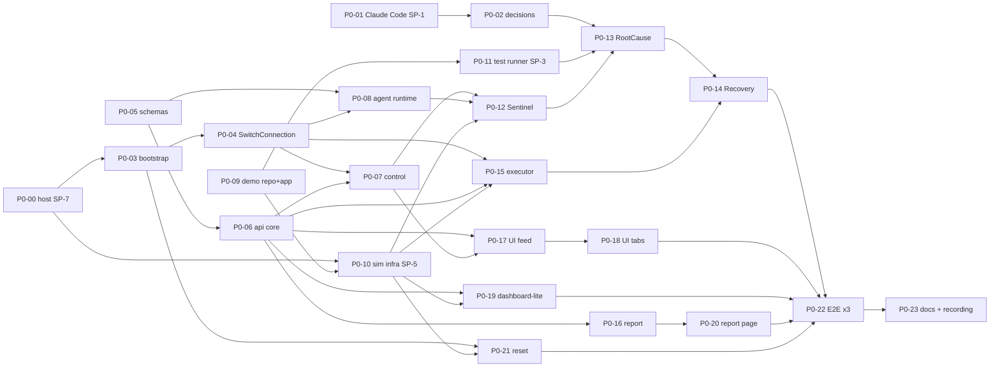

# 08 — Critical Path and 72-Hour Plan

## Assumptions

- **Team:** 3 engineers.
  - Lane A: Switch and agents.
  - Lane B: simulation and executor.
  - Lane C: API, UI and demo.
- **Productive time:** about 16 productive hours per engineer per 24 h over 72 h, which is about **48 h each and ≈ 144 h in total**. P0 is ≈ 141.5 h, so **slack is ≈ 0**. The P1 items below are taken only if lanes finish early.
- **With 2 engineers:** apply the "solo/duo cut" in §5.
- **With 1 engineer:** NO-GO for this scope (see `08-GO-NO-GO.md`).
- **Code freeze is at hour 60.** Hours 60–72 are rehearsal, reset hardening and recording only.

## 1. Dependency graph (P0)



## 2. Critical path

The longest dependency chain, measured in hours of work:

```
P0-00 host (1) → P0-03 bootstrap (4) → P0-04 SwitchConnection (6) → P0-08 agent runtime (6)
→ P0-12 Sentinel (7) → P0-13 RootCause (12) → P0-14 Recovery (8) → P0-22 E2E ×3 (6) → P0-23 recording (4)
= 54 h of sequential work in lane A (plus waits on lane B's P0-10/P0-11/P0-15)
```

**Implications:**

- **Lane A is the critical lane.** Anything that can leave it does. Lane B owns the executor (P0-15) and the test runner (P0-11). Lane C owns the schemas (P0-05) and the api (P0-06).
- **RootCause (12 h) is the single riskiest node.** It depends on the SP-1 outcome. The deterministic fallback patch (P0-13) must work **by hour 36**, regardless of the Claude Code status.
- **Recovery cannot finish before the executor (P0-15) exists.** Lane B must deliver the executor's verification half (SP-4) by hour 30 and its deploy half by hour 40.

## 3. Hour-by-hour plan

| Hours | Lane A (Switch and agents) | Lane B (sim and executor) | Lane C (API, UI and demo) | Gate at end of block |
|---|---|---|---|---|
| **0–4** | P0-01 SP-1 Claude Code runs (5 + 2 injected; A1/A2 probes) | P0-00 resize the host, start the SP-7 soak; begin P0-09 (app skeleton: pool, `pg_sleep`, metrics window) | P0-05 schemas; P0-06 DB schema plus the transition table | **H4:** SP-1 verdict → P0-02 decisions logged (host vs. container; fallback-primary or not) |
| **4–12** | P0-03 bootstrap script → P0-04 SwitchConnection (port the S3/S4/S6 harness code) | P0-09 finish the app, tests and `build_repo.py`; P0-10 the SP-5 calibration run on the demo host | P0-06 api core (tools, scopes, lock, SSE) | **H12 (blocking):** SP-7 passed (or an amd64 host chosen); SP-5 ranges met (or the 60 rps profile); SP-1 decided; bootstrap and SwitchConnection green on S3/S4 cases |
| **12–24** | P0-08 agent runtime → P0-12 Sentinel (to handoff) | P0-10 launcher, loadgen and monitor complete; P0-11 test runner (SP-3); start P0-15 (verification half = SP-4) | P0-07 Control (webhook, intake, event persistence) → P0-17 UI shell and feed (against recorded events) | **H24:** trigger → real degradation → alert → Sentinel handoff visible in Mattermost **and** in the UI feed |
| **24–36** | P0-13 RootCause (handoff verification, worktree, Claude Code adapter, **fallback patch first**, tests, post-checks, proposal) | P0-15 executor: verification complete (V-1 to V-12) by H30; freeze, deploy, verify, rollback by H36 | P0-17 finish the feed; P0-18 tabs (diff, tests, approval); P0-16 report generator | **H36:** RootCause posts a green proposal (real or labelled fallback); the executor deploys a pre-approved SHA in a scripted test |
| **36–48** | P0-14 Recovery (validation, card with the diff excerpt, outcomes, execution request, report trigger) | P0-21 reset; help lane A integrate the executor | P0-19 dashboard-lite; P0-20 report page | **H48: first full end-to-end run** (trigger → approve in Mattermost → measured recovery → report) |
| **48–60** | Bug fixes from E2E; P1-02 two-way exchange (only if E2E is green) | P0-22 E2E driver; E2E-2 (reject) and E2E-9 (typed approve); reset hardening | UI polish of the war room only; P0-23 docs | **H60: code freeze.** E2E-1 green three times in a row. |
| **60–72** | Rehearsals; timing (`05-DEMO-SCENARIO` §3.1) | Reset rehearsals; host stability watch | Recording: main take plus **a backup take**; edit (marked time skips only) | **H72:** submission |

## 4. Decision gates (fail → fallback, never silent)

| Gate | Condition | If it fails |
|---|---|---|
| G1 (H4) | SP-1 ≥ 4/5, no escape | Fallback-primary: the deterministic patch path is the default, labelled `[SIMULATED coding agent]`, and Claude Code is attempted first with a 60 s cap. If tools can read outside cwd → the container (P1-01) becomes P0, and lane A absorbs 6 h by dropping P1-02. |
| G2 (H12) | The SP-7 soak is stable | Move the demo to an amd64 VM (cloud), budgeting 3 h. Never record on an unstable host. |
| G3 (H12) | SP-5 ranges are met | The 60 rps × 200 ms profile. Still failing → widen the ranges. Never script the numbers. |
| G4 (H24) | Sentinel handoff visible end to end | Lane C pauses UI work to pair on the integration |
| G5 (H36) | The executor's verification and deploy pass in a scripted test | Cut P0-19 to static health tiles; lane C helps lane B |
| G6 (H48) | First full E2E | Cut all P1; freeze the UI scope at the feed plus the approval tab plus the report |
| G7 (H60) | E2E green 3× | Record the best run; disclose any manual step on screen |

## 5. Solo/duo cut (2 engineers, ≈ 96 productive hours)

Remove or simplify the following to reach ≈ 95 h:

| Item | Change | Saves |
|---|---|---|
| P0-19 | Dashboard-lite becomes a health strip inside the war room | −4 h |
| P0-20 | The report page becomes a Markdown report rendered in the war room's report tab | −2 h |
| P0-18 | The tabs become Diff and Approval only (no separate root-cause tab; the root cause shows in the feed) | −3 h |
| P0-17 | The feed keeps all row kinds, with simpler styling | −3 h |
| P0-12 | Sentinel uses deterministic evidence collection plus one LLM call for hypothesis and summary | −2 h |
| P0-14 | Recovery uses deterministic validation, binding and card; one LLM call for the narrative | −2 h |
| P0-21 | Reset becomes scripted, without UI integration | −1 h |
| P0-22 | One E2E repetition, plus manual rehearsals | −3 h |
| — | Skip all P1 | — |
| P0-13 | Fallback patch as the primary path; Claude Code best effort | ≈ −4 h of debugging risk |
| — | Leaves ≈ 116 h, still over 96 | **Further cut:** drop the separate Control WebSocket persistence. The UI reads `read_context` through Control on a 2 s poll instead of a stream. **−3 h, but weaker liveness.** Defer the hash chain (already P1). |

**Even the duo plan has no slack.** A duo should treat the hour-48 E2E as a hard checkpoint, and consider submitting the reduced demo.
