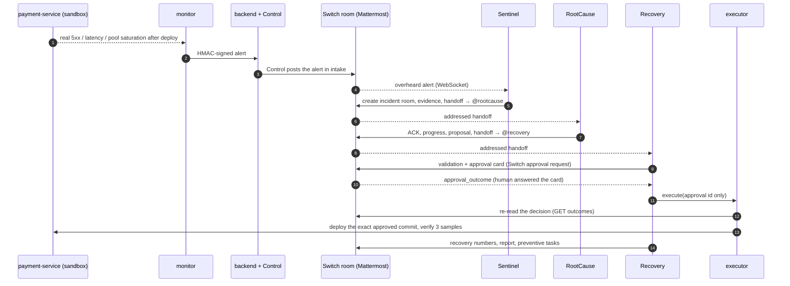

# 11 — Agents, Simulation and the First End-to-End Run (Tasks 11–12)

| | |
|---|---|
| **Status** | Built and run end to end against a real Switch server (self-hosted `0.31.0`, bundled Mattermost) |
| **Successful run** | 2026-11-07, faulty deploy at 05:55:10Z, `PREVENTIVE_TASKS_CREATED` at 05:56:54Z (**1 min 44 s**) |
| **Code** | `simulator/` (payment service, launcher, load, monitor), `backend/app/agents/` (runtime, Sentinel, RootCause, Recovery, executor), `backend/app/incidents/store.py`, `backend/app/api/webhooks.py`, `scripts/stack.sh` |
| **Gates** | G1 (Claude Code) **passed**, G3 (outage physics) **passed**, G2 (host stability) **still at risk** |

---

## 1. What the demo does



Agents never call each other's code. Each one's only trigger is its own Switch WebSocket. The store (SQLite) holds shared state and is used to cross-check handoffs, but it never wakes an agent.

## 2. Components

### 2.1 Simulator (`simulator/`)

| Part | Behavior |
|---|---|
| `seed/payment-service/` | A FastAPI payment API. Each payment holds one pooled SQLAlchemy connection (async, AsyncAdaptedQueuePool, SQLite through aiosqlite) for the scoring step (`SIM_SCORING_SECONDS`, 0.1 s). `/health`, `/metrics/summary` (rolling 15 s window), JSON logs. 10 unit tests. |
| `simulator/build_repo.py` | A deterministic git history. **C4** `0fccbb3` (deploy #841, `pool_size: 50`) is healthy. **C5** `9d33906` (deploy #842, "chore(db): reduce pool…") sets `pool_size: 10`, plus a log-level red herring. |
| `simulator/launcher.py` | The sandbox runtime and the only deploy path. Bearer token checked **before** the body; deploys an exact SHA via `git archive` with a tree check; restarts the service; verifies the readiness and the SHA reported by `/health`; auto-reverts on failure; appends to `deployments.jsonl`. |
| `simulator/loadgen.py` | Open-loop 120 rps (seeded). Caps in-flight requests and skips missed arrivals after a stall instead of bursting them. |
| `simulator/monitor.py` | Scrapes every 5 s; rules for 5xx > 5 %, p50 > 1 s and pool > 90 % over 2 samples. Sends HMAC-signed `firing`/`resolved` webhooks. |
| `simulator/ctl.py` | `reset` (back to HEALTHY), `trigger` (deploys C5 through the launcher), `status` |

**Calibration (gate G3), measured:**

| State | 5xx | p50 | DB pool |
|---|---|---|---|
| HEALTHY (C4) | 0.17–0.22 % | ~101 ms | ~25 % |
| DEGRADED (C5), steady state | 18–21 % | ~4.05 s | 100 % |
| After the fix | 0.22 % | ~101 ms | ~25 % |

These are produced by real pool saturation, not scripted. The log carries SQLAlchemy's own `QueuePool limit of size 10 overflow 0 reached, connection timed out, timeout 4.00`.

### 2.2 Backend additions

- **Migration `0002_incident_store`:** the `incidents`, `handoffs`, `remediations`, `approvals` and `executions` tables. `executions.approval_id` is unique, so an approval can be executed at most once.
- **`app/incidents/store.py`:** the transition table, with each state change allowed to exactly one actor; audit events for every write; a single active incident at a time.
- **`app/api/webhooks.py`:** verifies the HMAC, a 300 s timestamp window, the replay cache, a strict schema, a size limit and the service catalog. Then Control posts the alert into the intake room as canonical JSON.

### 2.3 Agents (`backend/app/agents/`)

| Agent | Trigger (Switch event) | Does | Uses an LLM for |
|---|---|---|---|
| **Sentinel** | An alert posted by Control in intake (overheard) | Opens the incident and its room; waits for the metrics window to settle; collects real evidence (metrics, log signatures, deployments, git diff); judges severity; hands off to RootCause | Hypotheses (Claude, text only; labelled deterministic fallback) |
| **RootCause** | An addressed `investigation` / `revision_request` handoff | Verifies the handoff; localizes the fault from the real diff and `capacity.yml`; clones an isolated worktree; runs **Claude Code** (Read/Edit/Write/Grep/Glob only, confined to the worktree); runs the tests itself; proves the new test fails on the faulty commit; runs post-checks; commits; hashes the canonical diff; hands off to Recovery | Claude Code writes the patch. A deterministic fallback patch, labelled `[SIMULATED]`, is used only after 2 failed attempts. |
| **Recovery** | An addressed `remediation_proposal`; `approval_outcome` | Re-validates independently (hash recomputed, tests, allowlist, base deployed); binds and opens the Switch approval card with the diff excerpt; on approve, starts the executor; on reject, sends a revision request; posts the report and preventive tasks | — (deterministic) |
| **executor** (separate process) | Recovery passes it an approval id | Re-reads the decision from Switch and checks it against the binding (Task 10 verifier); freezes the commit into the demo repo and recomputes the hash; checks that the parent is the approved base and the base is what's deployed; claims single use; deploys via the launcher; verifies 3 consecutive samples (5xx < 1 %, p50 < 300 ms, pool < 80 %, ≥ 1000 requests, correct SHA); rolls back if not; only then `/delivered` | — |

**Handoff protocol:**
1. The sender records the handoff in the store, then posts it to Switch: a summary line plus a fenced `blackbox.handoff/v1` JSON block, addressed with `send_targeted_message`.
2. The receiver accepts it only if all of these hold:
   - the Switch `sender` equals that agent's **pinned** sender id;
   - a store record exists;
   - the payload hash matches the record.
3. The receiver ACKs in Switch.

## 3. The successful run (2026-11-07)

| Time (UTC) | Event (all visible in the Switch room) |
|---|---|
| 05:55:10 | `ctl trigger` deploys C5 as #842 |
| ~05:55:20 | The monitor fires ALT-1882; Control posts it in intake; Sentinel opens INC-1042 and `#incident-payment-service-1042-6c73` |
| ~05:55:35 | Sentinel posts evidence (DB pool 99.8 %, `QueuePool limit of size 10` errors starting ~12 s after #842) and sends the `HND-1042-001` handoff to RootCause |
| ~05:55:40 | RootCause ACKs, then `ROOT_CAUSE_FOUND` (`pool_size 50→10` below the required 30; `log_level` change ruled out) |
| ~05:55:50 | Claude Code (attempt 1) restores `pool_size: 50` and adds `test_pool_capacity_meets_peak_concurrency`; **11/11 pass**; the new test fails on C5; `HND-1042-002` goes to Recovery |
| 05:55:55 | Recovery `VALIDATION PASSED`; approval `APR-1042-1` opened (`INC-1042:REM-1042-1:57750f3acb63dc1a:staging-sandbox:d66b8e0b`) |
| ~05:56:05 | The IC's identity answers the card (`A1 1`); Switch pushes `approval_outcome` approve |
| ~05:56:10 | The executor re-reads the decision from Switch and passes all checks; deploys `cead6c0` as #843 |
| 05:56:22 → 05:56:32 | Verification samples, 3/3 passing |
| 05:56:54 | `RESOLVED → POSTMORTEM_GENERATED → PREVENTIVE_TASKS_CREATED` |

**Measured:** 5xx **20.66 % → 0.22 %**, p50 **4,066 ms → 100.9 ms**, DB pool **98.3 % → 24.7 %**.

**State path** (each step validated and audited):

```
DETECTED → INVESTIGATING → ROOT_CAUSE_IDENTIFIED → REMEDIATION_STAGED → VALIDATING → AWAITING_APPROVAL
→ APPROVED → EXECUTING → VERIFYING → RESOLVED → POSTMORTEM_GENERATED → PREVENTIVE_TASKS_CREATED
```

**What is real and what isn't:**
- Switch, Mattermost, the agents, Claude Code, the tests, the deploys and the metrics are real.
- Traffic is simulated (load generator), and so is the deploy metadata's author ("ci-bot").
- **The approval was given by the labelled test harness acting as the IC**: it logged in to Mattermost as `user` and replied with the card handle `A1 1`. Switch applied its own answerer authorization. No person clicked.

## 4. Findings from the build, and their fixes

| # | Finding | Fix |
|---|---|---|
| F10 | Message `sender` ids (`@switch-agent-…`) are not exposed by the roster APIs, so a roster-based identity check rejected a genuine handoff | Bootstrap **pins** each agent's sender id: each posts once in an identity room. Receivers require an exact match. |
| F11 | After a restart, catch-up replayed old room history: an old alert re-opened an incident, and old handoffs were reprocessed | Catch-up only considers messages posted after the process started. Sentinel ignores alerts observed before it started or older than 120 s. RootCause/Recovery skip handoffs already acknowledged. |
| F12 | Switch remembers approval request ids across BLACKBOX resets: an identical patch got the same id, and the re-open was refused with `REQUEST_CONFLICT` | `request_id` gains a random per-binding nonce, stored in the binding and re-verified |
| F13 | Switch posts greetings in each agent's name when it joins a room | Bootstrap turns off `agent_greetings_enabled` on the bridge (Gateway `PATCH /gateway/collaborations/{id}`) |
| F14 | Mattermost (amd64-only, emulated) hung 3 more times. One approval card rendered **without buttons** after a restart | Restart Mattermost. The card's typed handle (`A<n> <option>`) is the documented alternative. **G2 remains open.** |
| F15 | The launcher validated the body before the token (422 instead of 401) | Authenticate first (constant-time comparison) |
| F16 | After the host slept, the open-loop load generator burst every missed request and wedged. The executor then saw 0 traffic and **correctly rolled back** instead of claiming recovery | Skip missed arrivals; cap in-flight requests |
| F17 | `source .env` stripped the quotes inside the JSON-valued `BLACKBOX_CORS_ORIGINS` | Single-quote the value |
| F18 | Sentinel's first message uses the alert's early severity (SEV-2), before the metrics settle; the incident is then correctly upgraded (SEV-1) | Open: post the severity after evidence collection |

## 5. How to run it

The Switch stack must be running. `.env` must hold the `SWITCH_*`, `MATTERMOST_*`, `SIM_LAUNCHER_TOKEN` and `BLACKBOX_WEBHOOK_SECRET` settings (see `.env.example`).

Register the agents, pin their identities and create the intake room. This is a one-time step; `--as-ic` makes the harness post the IC check message.

```bash
make agents-bootstrap
```

Reset the simulator to HEALTHY:

```bash
make sim-reset
```

Start the launcher, service, backend, load, monitor and the three agents:

```bash
make stack-up
```

Deploy C5 (the faulty deploy #842):

```bash
make sim-trigger
```

Then approve on the card in the Mattermost incident channel (http://localhost:8065, user `user`).

Stop everything:

```bash
make stack-down
```

Logs are written to `simulator/runtime/logs/<component>.log`.

## 6. Open items

1. Recovery doesn't yet send a revision request after a **rollback** (`ROLLED_BACK → NEEDS_REVISION`).
2. Finding F18 (Sentinel's early severity in its first message).
3. A run where a person approves in Mattermost (only the harness has approved so far).
4. Gate G2: give Docker ≥ 4 CPUs / 6 GB, or use an amd64 host.
5. Not built: the war-room UI, the full report page, reject/revoke UI flows, the coding-agent container (P1), and automated end-to-end tests.
