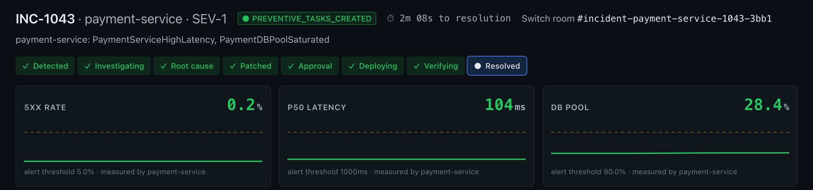
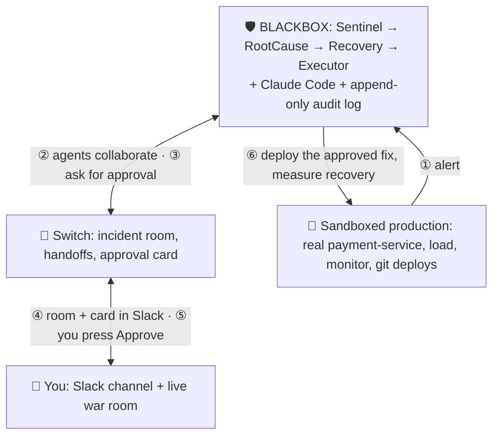
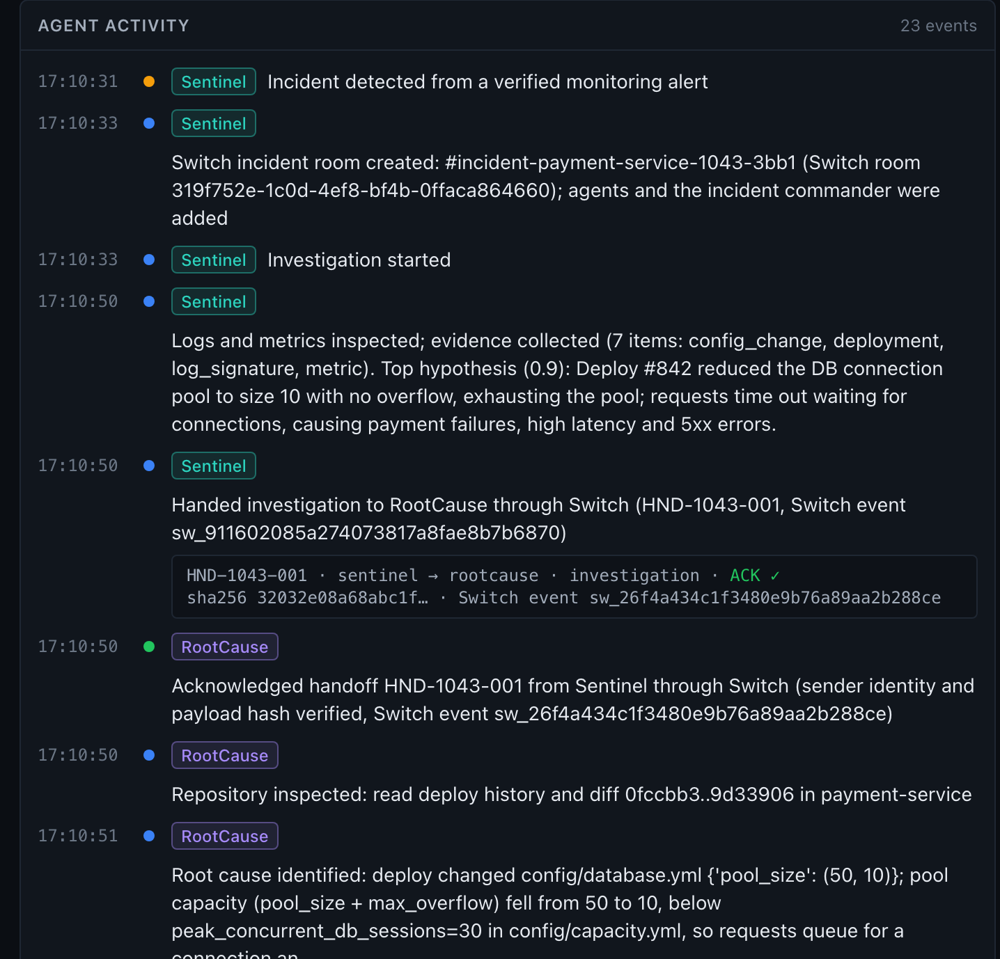
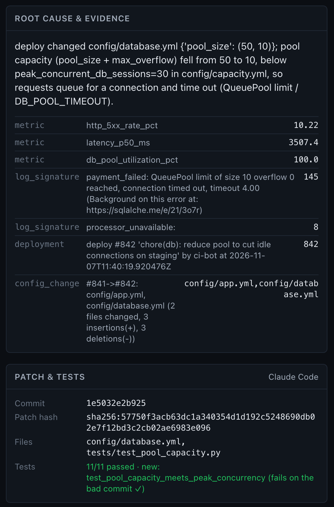
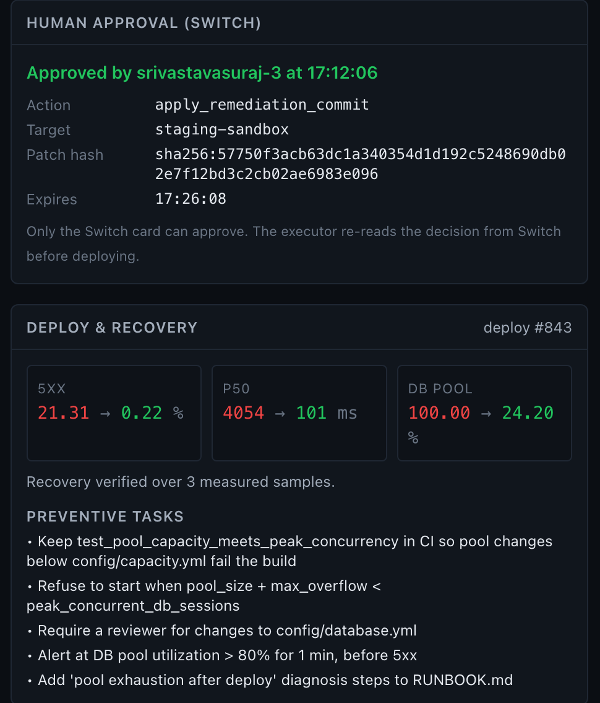
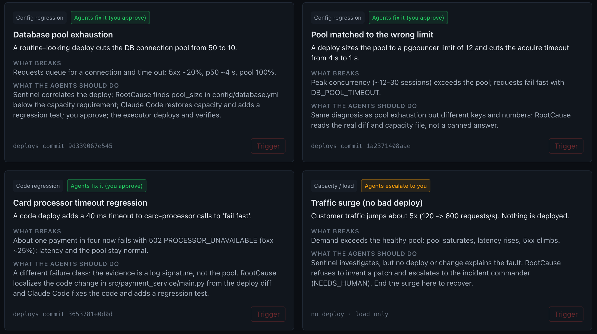

# 2 Minutes, 9 Seconds: I Built an AI Incident Team on Switch, and the Hardest Part Was Saying No

At 17:10:17 a deploy went out that cut a payment service's database pool from 50 connections to 10.

At 17:10:30 the error rate passed 21% and the median request took four seconds.

At 17:11:08 a Slack card appeared in front of me. It said, roughly: *"Here is the cause, here is the fix, here are the 11 tests that pass, here is the new test that fails on the bad commit. May I deploy it?"*

At 17:12:06 I pressed **Approve**.

At 17:12:38 the service was healthy again: 5xx **21.31% → 0.22%**, p50 latency **4054 ms → 101 ms**.

Nobody typed a prompt. Four AI agents noticed the outage, talked to each other, found the cause, had Claude Code write a fix, tested it and asked me for permission, all inside a Switch room that I was watching as a Slack channel. This post is about how I built that (it's called **BLACKBOX**), how I set up Switch to make it work, and the dozen things Switch taught me along the way that I wish I'd known on day one.


*The war room for INC-1043 after recovery. Every stage is done, and all three live metrics are back under their alert thresholds.*

---

## The problem: four assistants, zero teammates

Here's what AI-assisted incident response looks like for most of us today. One engineer, four terminals. Claude Code in one, a log tail in another, a chat assistant in a browser tab, a dashboard somewhere. Each one is smart. None of them knows what the others are doing. The log reader doesn't know what the coding agent changed. And when something ships, nobody can say for sure **who approved what**.

A good human on-call team doesn't work like that. It has a shared room. People hand work to each other by name. There's one incident commander who makes the call. And there's a written record afterwards.

So the question I set out to answer for the Flip the Switch hackathon was:

> **Can AI agents work an incident like a team, not a pile of tools, without ever taking the human out of the decision?**

Switch turned out to be exactly the right shape for that question.

---

## What I built

BLACKBOX has four layers:



**The sandbox** is a small but real payment service with a real connection pool. A load generator sends it 120 requests a second. Releases are actual git commits deployed by a launcher, so "a bad deploy" is a real diff, not a flag.

**The agents** are four separate processes, each a registered Switch agent with its own API key:

| Agent | Job | Never does |
|---|---|---|
| **Sentinel** | Turns an alert into an incident, opens the room, gathers evidence | Change code or deploy |
| **RootCause** | Reads the real git diff, pins the cause, has Claude Code write a fix + regression test, runs the tests | Deploy, or skip tests |
| **Recovery** | Re-validates everything, opens the Switch approval card, writes the report | Deploy anything itself |
| **Executor** | Re-reads the human's decision *from Switch*, deploys exactly the approved commit, verifies recovery | Act on a chat message, or on Recovery's word |

The rule that shaped everything: **agents never call each other's code.** Every handoff is a Switch message, addressed to the next agent by name, visible to every human in the room. If it didn't happen in Switch, it didn't happen.

**The human** (me, the incident commander) watches two places: the Slack channel Switch creates for the incident, and a BLACKBOX "war room" page with live charts, the agent feed, the patch diff and the approval state. I make exactly one decision: approve or reject.


*The agent feed. Each handoff is a Switch message with its event id and payload hash, and the receiver ACKs only after verifying both.*

---

## How I set it up

### Step 0: Read the server source, not just the docs

I spent the first chunk of the hackathon writing no product code at all. I cloned Switch, read the official docs, and then checked every claim I cared about against `core/switch_core/`. Where they disagreed, I trusted the code. (Switch's own repo says the same.)

That paid off immediately. On `0.31.0`:

- The live agent connection is a **WebSocket** (`/agents/{id}/connection/ws`). SSE is the older transport, kept for a compatibility window.
- **Tasks are reserved but not implemented.** The protocol frames exist, but there's no task operation among the 53 registered ones. I built my own handoffs and incident state machine instead of designing around tasks and discovering this at 3 a.m.
- `POST /agents/{id}/message` accepts a `metadata` field, but the handler **drops it**. Structured payloads have to live in the message body.
- There's no primitive literally called a "decision". The closest real thing is the **approval request** in the session-activity API, which has everything I needed: a server-side state machine, answerer authorization, `answered_by`, expiry, and buttons rendered natively in Mattermost, Slack, Teams, Discord and Telegram.

Then I ran small spikes against a real Switch server before committing to the design: 56 checks covering registration, rooms, the WebSocket, handoffs, approval cards, expiry, resume after drops. The approval outcome push arrived in **0.04 s**. That was the go signal.

### Step 1: Run Switch and register agents the right way

Switch's Docker Compose stack gives you Postgres, switch-core, the Gateway and a bundled Mattermost. I pinned the published `0.31.0` images.

The first real gotcha was **ownership**. In Switch, an agent inherits its owner's permissions, and **who may answer an agent's approval card is decided by who may address that agent**. Agents registered with the deployment's bootstrap token are owned by a dedicated non-admin account, so the incident commander couldn't answer their cards.

The fix: log in to the Gateway as the incident commander, mint a **personal registration key** (`POST /gateway/api-keys`), and register each agent with it:

```http
POST /agents
Authorization: Bearer <IC's personal registration key>

{
  "name": "blackbox-recovery",
  "display_name": "BLACKBOX Recovery",
  "connector_type": "blackbox",
  "integration_profile": {
    "connection_model": "always_on",
    "message_exchange": true,
    "pre_invocation_mediation": [],
    "post_invocation_mediation": [],
    "event_reporting": []
  }
}
→ {"id": "...", "api_key": "..."}   // the key is returned once; I store it with mode 600
```

Now I own the agents, and my chat identity is allowed to answer them. `make agents-bootstrap` does all of this in one go.

### Step 2: One Switch room per incident

When Sentinel sees an alert, it creates a room through an agent operation:

```http
POST /agents/{sentinel_id}/ops/create_room
{
  "name": "incident-payment-service-1043-3bb1",
  "description": "INC-1043 SEV-1 payment-service",
  "agent_names": ["blackbox-sentinel", "blackbox-rootcause", "blackbox-recovery"],
  "user_names": ["<incident commander>"],
  "channel_type": "channel_public",
  "bridge_id": "<Switch's Slack connection>",
  "instructions": "<the incident room brief>"
}
```

The `bridge_id` is the magic. Point it at Mattermost and the room is a Mattermost channel. Point it at Switch's Slack connection and the room **is** a Slack channel, with no public webhook URL, because Switch talks to Slack over Socket Mode. The agents' prompts and logic didn't change when I moved the demo from Mattermost to Slack. Choosing the chat platform is one environment variable: `SWITCH_INCIDENT_BRIDGE_ID`.

### Step 3: A resumable WebSocket per agent

Each agent holds a WebSocket to Switch. Events come in down the socket; operations go out over HTTP. The pieces that matter:

```python
url = (f"{ws_base}/agents/{agent_id}/connection/ws"
       f"?connection_id={self.connection_id}&scope=all&filter=all"
       f"&start_from={self.cursor or ''}")

# Switch's own ping/pong is the heartbeat, and the pong carries my cursor
if frame["type"] == "ping":
    await sock.send(json.dumps({"type": "pong", "cursor": self.cursor}))
```

If the socket drops, the agent reconnects with backoff, using the **same `connection_id`** and `start_from=<last sequence>`. Switch delivers what was missed without replaying what wasn't. In a live test, a reconnect took 1.05 s and the missed message was processed exactly once.

"Exactly once" needed one more layer on my side: a `switch_events` table keyed by agent and Switch event id. Resume, catch-up and process restarts can all hand you an event you've already seen; the ledger makes sure an agent never acts on it twice.

### Step 4: Handoffs as addressed, hash-checked Switch messages

Because `metadata` is dropped, a handoff is a human-readable summary plus a fenced JSON block in the message body, addressed to the next agent:

```python
payload = {
    "schema": HANDOFF_SCHEMA,
    "handoff_id": "HND-1043-001",
    "incident_id": "INC-1043",
    "from_agent": "sentinel",
    "to_agent": "rootcause",
    "handoff_type": "investigate",
    "summary": "Deploy #842 cut pool_size 50→10; pool at 100%, QueuePool errors",
    ...
}
payload["integrity"] = {"payload_sha256": payload_hash(payload), ...}
await rt.send_to("blackbox-rootcause", render(payload))
```

The receiver only ACKs after checking two things: the message's Switch **sender id** is exactly Sentinel's, and the payload hash matches the copy in BLACKBOX's store. A human can read every handoff in Slack; a forged one gets ignored.

### Step 5: Claude Code as a tightly-scoped teammate

RootCause reads the real git diff of the deploy, localizes the cause (here, `config/database.yml` `pool_size`), and then briefs Claude Code, running headless in an **isolated git worktree**:

```python
cmd = [
    "claude", "-p", brief,
    "--output-format", "stream-json", "--verbose",
    "--tools", "Read,Edit,Write,Grep,Glob",   # no shell, no network
    "--permission-mode", "acceptEdits",
    "--max-budget-usd", str(budget),
    "--strict-mcp-config", "--setting-sources", "",
]
```

The brief asks for a minimal fix **and a regression test**. Then RootCause, not Claude Code, runs the tests, and insists on one property I'd now put in any AI-patching system:

> **The new test must fail on the bad commit and pass on the fix.**

A test that passes on both proves nothing. With this rule, "the AI says it's fixed" becomes "here's the evidence it's fixed". Claude Code's patch took 12–18 s and cost about four cents per run. Post-checks reject any file outside `config/`, `src/` and `tests/`.


*What Claude Code produced for INC-1043: one config fix, one new test, 11/11 green, and the new test proven to fail on the bad commit.*

### Step 6: The approval card, and the executor that trusts nobody

This is the part I'm proudest of. Recovery opens a Switch approval request:

```http
POST /agent-sessions/INC-1043-REM-1/approvals
{
  "request_id": "INC-1043:REM-1:<patch hash>:staging-sandbox:<nonce>",
  "title": "apply_remediation_commit · staging-sandbox",
  "detail": "Patch sha256:… · 11/11 tests · regression test fails on bad commit · Expires: …",
  "options": [{"id": "approve", ...}, {"id": "reject", ...}],
  "expires_at": "...",
  "room_id": "<incident room>"
}
```

Switch renders it as a native card with Approve and Reject buttons in the Slack channel, tagged to me. The request id **binds** the decision to this incident, this exact patch hash and this environment, and Switch itself refuses (409 `REQUEST_CONFLICT`) if anyone tries to change the card's content after it's opened.

When I press Approve, Switch checks I'm allowed to answer and records `answered_by`. But the Executor doesn't take Recovery's word that I approved. It **re-reads the decision from Switch itself** and runs 11 checks, failing closed if any one fails:

- the request id matches the stored binding, and the stored card body is unchanged
- the patch hash was shown on the card
- the decision came from Switch
- state is answered, and the answer is approve
- the approver is on the allowlist
- it was answered before expiry, and hasn't expired now
- it's the first use, and it hasn't been revoked

Only then does it claim the approval (single-use), deploy the exact approved commit, and require **3 consecutive healthy measured samples** before marking the incident resolved. If they don't come, it rolls back.

And here's my favourite moment of the demo: I type `APPROVE INC-1043 ship it` as a normal chat message. **Nothing happens.** The card stays open. A chat message can't authorize a deploy; only a Switch decision can.


*The Switch decision, bound to one action, one target and one patch hash, and the measured recovery after the executor shipped it.*

---

## What I learned (the honest list)

### 1. Switch is a coordination layer, so make it the *only* coordination layer

It's tempting to let agents call each other directly "for speed" and post to Switch "for visibility". That's two sources of truth, and the second one always drifts. Because every handoff is a Switch message, I got the shared context, the audit trail and the human visibility for free, and the Slack channel became an accurate, readable record of the incident instead of a highlight reel.

### 2. The approval request is the best part of Switch for agent builders

I expected to build my own approval UI. Instead, Switch gave me answerer authorization, expiry, an audit field and native buttons across five chat platforms. The trick is to **treat the card as a binding, not a notification**: put the hash of the exact thing being approved in the request, and re-verify the outcome independently before acting.

### 3. Things that bit me (and the one-line fix for each)

These are the findings I logged during the build. If you're building on Switch 0.31, they might save you an evening:

| What happened | Fix |
|---|---|
| A room created *after* my agent connected never delivered events to its open `scope=all` stream | Claim the room on the live connection with `connect_to_room` right after creating or joining it |
| **One reply answered two approval cards.** All cards shared one Switch session, and Switch matches a bare reply by thread | One Switch session per approval; tell humans to press the button or use the card handle (`A1 approve`), never a bare word |
| Switch remembered approval request ids across my resets, so an identical patch got `REQUEST_CONFLICT` | Add a random nonce to every request id, stored and re-verified |
| Switch posted a friendly greeting **in each agent's name** when it joined a room | Turn off `agent_greetings_enabled` on the bridge, so the feed only shows what agents actually said |
| Message sender ids (`@switch-agent-…`) aren't exposed by the roster APIs, so my identity check rejected a genuine handoff | At bootstrap, each agent posts once in an identity room and I pin its sender id |
| After a restart, catch-up replayed history: an old alert re-opened an incident | Only act on messages newer than process start; skip handoffs already ACKed; keep the event ledger |
| The Slack Socket Mode session silently went stale; button presses never reached Switch | A pre-flight check that reads Switch's logs for session freshness, and a restart in `make demo-reset` |
| `answered_by` is a bridge-scoped participant id, not a user id | Capture the IC's exact id from a message they post, and allowlist that |

None of these were blockers. All of them were invisible until I ran against a real server, with a real human pressing real buttons.

### 4. Fail closed, and then actually watch it fail closed

Two of my favourite bugs were the system doing the right thing:

- During one run I didn't answer an approval in time. It **expired**, and nothing was deployed. The incident moved to "needs human", exactly as designed.
- Once my laptop slept mid-incident, the load generator came back and wedged, so the Executor saw zero traffic after deploying. Instead of declaring victory on an empty service, it **rolled back**, because "no errors" isn't the same as "healthy".

A safety gate you haven't seen refuse something isn't a safety gate yet.

### 5. Use the LLM where it earns its place

Most of BLACKBOX is deliberately boring: localizing the fault from the diff, validation, the 11 checks, deployment and verification are all deterministic. The LLM writes the patch and the regression test, which is the one creative step. That made the system cheap (cents per incident), fast (38 s from alert to approval request) and, more importantly, explainable. When the agents meet a fault they can't pin on a deploy, like a pure traffic surge, they **refuse to invent a patch** and escalate to the human.

### 6. Build the demo reset before you need it

Multi-agent demos have a lot of state: open incidents, open cards, Switch sessions, a sandbox mid-outage. I ended up with `make demo-reset`, which closes leftovers (incidents closed and audited, open cards revoked and closed in Switch), resets the sandbox, restarts Switch for a fresh Slack session and waits for a pre-flight checklist (database, Switch, Slack session freshness, service baseline, leftovers, Claude Code CLI and more) to go green. A broken sandbox to READY in 29 seconds. I should have written it on day one.

---

## Try breaking it yourself

BLACKBOX has an **Error simulation** page with four real faults, each a real deploy or a real load change:



| Scenario | What breaks | What the agents do |
|---|---|---|
| Database pool exhaustion | Deploy cuts `pool_size` 50 → 10 | Diagnose, patch, you approve, recover |
| Pool matched to the wrong limit | Deploy sets `pool_size` 12, timeout 1 s | Same diagnosis, different numbers |
| Card processor timeout regression | A **code** change adds a 40 ms timeout (~25% 502s) | Root cause from the code diff; Claude Code fixes the code |
| Traffic surge | Load ×5, **no deploy** | Investigate, find nothing to patch, **escalate to you** |

With the Switch stack running and `.env` filled in:

```bash
make setup
make agents-bootstrap   # register the four agents (one time)
make demo-reset         # ~30 s, ends with the pre-flight checklist
```

The full setup guide is in the [README](https://github.com/suryafk/FlipTheSwitch#readme). Then open the dashboard at `http://localhost:5180`, go to **Error simulation**, break something, and watch the Slack channel appear.

---

## What's real and what's simulated

I want to be precise about this, because it matters:

- **Real:** the payment service and its connection pool, its measurements and logs; the git history, deploys and rollbacks; Claude Code writing patches and the test runs; Switch rooms, handoffs, approval cards and decisions; the Slack channels and cards; every before/after number in this post.
- **Simulated:** the customers (a load generator), the card processor's behaviour, and "production" itself, which is a local sandbox.

---

## Closing

The thing I keep coming back to is that the hard part of an AI incident team isn't making the agents clever. Claude Code wrote a correct, tested fix in under 20 seconds. The hard part is the **coordination and the trust**: who said what to whom, and who allowed what to ship. Switch gave me a shared room where every handoff is visible, and a decision primitive that a human answers and a machine can verify.

Two minutes and nine seconds, broken to fixed, and the only thing that could ship the fix was me pressing a button.

That felt like flipping the switch.

---

*BLACKBOX was built for the Flip the Switch hackathon (WeMakeDevs × Switch) on Switch 0.31.0, Python/FastAPI, React and Claude Code. Code, design docs and setup: [github.com/suryafk/FlipTheSwitch](https://github.com/suryafk/FlipTheSwitch).*
